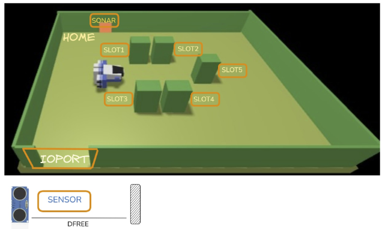

# Project_ISS

Il progetto in questione è il tema finale per l'insegnamento di Ingegneria dei Sistemi Software M 2025-2026.

## Il progetto Cargoservice

**Cargoservice** è un sistema software che gestisce il carico di container in una _hold_ (stiva) a 4 slot, usando un Differential Drive Robot (_cargorobot_) simulato nell'ambiente virtuale WEnv.



Il cliente richiede il carico tramite il pushbutton dell'IOPort; il sistema verifica che sia operativo, che l'IOPort sia libero e che esista uno slot disponibile, quindi riserva lo slot e comunica il nome al cliente. Quando il sonar rileva il container, il cargorobot lo porta nello slot5 per la marcatura (codice a barre) e poi nello slot riservato. Il display mostra lo stato della hold e del servizio (`Service working` / `Out of service`).

Il sistema è modellato con il metamodello **Qak** (Quasi Actor Kotlin) e sviluppato in modo incrementale per sprint, seguendo le fasi di analisi dei requisiti, analisi del problema, progetto e test.

## Documenti principali

| Documento                                                                                                 | Contenuto                                                                                                      |
| --------------------------------------------------------------------------------------------------------- | -------------------------------------------------------------------------------------------------------------- |
| [Requisiti del committente](https://anatali.github.io/issLab2026/_static/docs/Protobook.pdf#section.31.1) | Testo originale dei requisiti                                                                                  |
| [Sprint0](UserDocs/sprint0.md)                                                                            | Requisiti formalizzati, macrocomponenti, core business, architettura di riferimento, piano di test e di lavoro |
| [Sprint1](UserDocs/sprint1.md)                                                                            | Core business: ciclo di carico (cargoservice, cargorobot e hold), analisi del problema, test                  |

## Mappa della repository

```
Project_ISS/
├── README.md                 questo file
├── LICENSE
├── UserDocs/
│   └── sprint0.md            documentazione Sprint0 in formato markdown
│   └── sprint0.pdf           documentazione Sprint0 in formato pdf
│   └── sprint1.md            documentazione Sprint1 in formato markdown
│   └── sprint1.pdf           documentazione Sprint1 in formato pdf
├── img/                      immagini e diagrammi usati nella documentazione
└── project_Cargoservice/
    ├── cargoservice_sprint0/ progetto Gradle Sprint0
    │   ├── src/sprint0.qak   modello Qak
    │   ├── src/it/unibo/     codice Kotlin generato dagli attori
    │   ├── src/test/java/    test
    │   └── Arch_Sprint0.py   diagramma dell'architettura
    ├── cargoservice_sprint1/ progetto Gradle Sprint1
    │   ├── src/sprint1.qak   modello Qak
    │   ├── src/it/unibo/     codice Kotlin generato
    │   ├── src/test/java/    CargoServiceTest, CargoServiceWorkerTest, HoldTest
    │   └── Arch_sprint1.py   diagramma dell'architettura
    └── unibolibs/            librerie Unibo (qakactor, basicomm, 2p, interfacce)
```

## Team

Team di sviluppo in ordine alfabetico: **Cenerini Francesco, Leoncini Niccolò, Tasinato Pietro Milo**.
