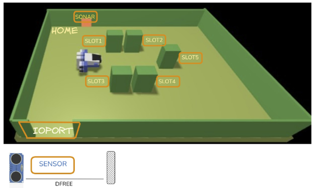
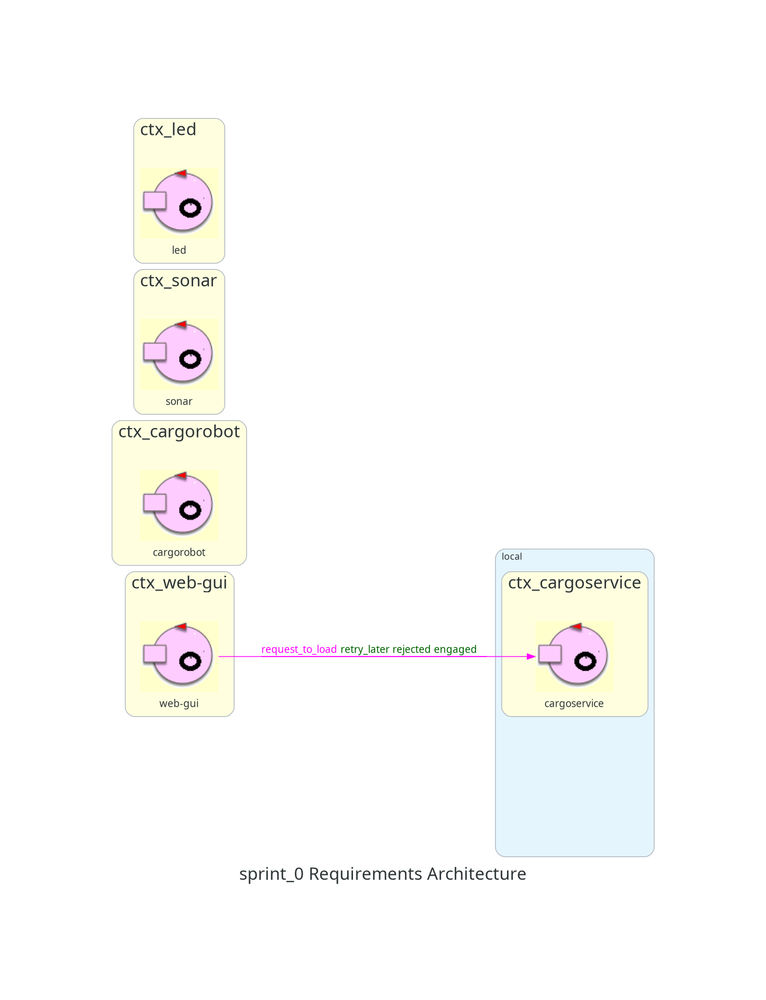

# Sprint0

## Indice

- [Introduzione](#introduzione)
- [Requisiti](#requisiti)
- [Analisi dei Requisiti](#analisi-dei-requisiti)
- [Piano di Test](#piano-di-test)
- [Testing](#testing)
- [Deployment](#deployment)
- [Piano di lavoro](#piano-di-lavoro)
- [Team di lavoro](#team-di-lavoro)

## Introduzione

L'obiettivo dello Sprint0 è formalizzare quanto più possibile i requisiti forniti dal committente nel documento [TemaFinale26](https://anatali.github.io/issLab2026/_static/docs/Protobook.pdf#chapter.31), individuare le macro-parti del sistema e la loro natura software (distinguendo i componenti forniti dal committente da quelli da sviluppare), riconoscere il core business, predisporre un primo insieme di TestPlan funzionali e definire un primo modello del sistema da utilizzare come riferimento negli sprint successivi.

In particolare, il primo modello dei requisiti deve essere, ove possibile, comprensibile alla macchina, senza introdurre componenti, messaggi o comportamenti che non emergono esplicitamente dai requisiti. Per questo motivo il modello potrà risultare non eseguibile o eseguibile solo in parte.

## Requisiti

I requisiti sono descritti dal committente nel documento [TF2026 Requirements](https://anatali.github.io/issLab2026/_static/docs/Protobook.pdf#section.31.1). Per comodità, riportiamo di seguito il suddetto documento, tradotto in lingua italiana:

Una compagnia di trasporto marittimo merci, da ora in poi semplicemente **company**, intende automatizzare le operazioni di carico dei **container** nella stiva della nave, da ora in poi semplicemente **hold**. A tale scopo, la compagnia intende impiegare un robot a guida differenziale, da ora in poi chiamato **cargorobot**.

La hold è un’area rettangolare e piana dotata di una porta di Input/Output, chiamata **IOPort**. L’area fornisce `4 slot` per immagazzinare i container e uno slot chiamato **slot5**.



Nella figura sopra:

- I **slots1-4** rappresentano le aree della stiva riservate a contenere un _container_ ciascuna.
- Lo **slot5** rappresenta un’area in cui il _cargorobot_ deve depositare temporaneamente un container prima di collocarlo in uno degli _slots1-4_. Durante questa sosta temporanea, un dispositivo chiamato marker etichetta il container con un codice a barre identificativo e segnala quando l’attività di marcatura è completata.
- L’**IOPort** è un dispositivo dotato di un **pushbutton** e di un **display**. Il _pushbutton_ viene premuto dal cliente per inviare una richiesta di carico di un container nella stiva. Il _display_ viene usato per mostrare la risposta alla richiesta e per mostrare lo stato corrente dell'_hold_.
- Il **sensore** associato all’_IOPort_ è un dispositivo, cioè un _sonar_, usato per rilevare la presenza di un container quando misura una distanza D tale che D < DFREE / 2 per un tempo ragionevole, per esempio 3 secondi.

La compagnia ci chiede di costruire un servizio chiamato **cargoservice**, che deve funzionare come segue. Il _cargoservice_ è in grado di ricevere una **richiesta di carico** di un container inviata da un cliente tramite il _pushbutton_ dell’_IOPort_.

Il servizio:

- Invia la risposta `retrylater` se l’**IOPort** è attualmente occupato da un container oppure se il sistema è _Out of service_.
- Rifiuta la richiesta quando la stiva è già piena, cioè quando gli `slots1-4` sono già occupati.
- Altrimenti, considera il sistema come **engaged**, individua uno slot libero e restituisce come risposta il nome dello slot riservato. Mentre il sistema è engaged, deve lampeggiare un LED.

Quando la _richiesta di carico_ viene accettata, il cliente deve spostare il container nell’area del _sensore_ entro un tempo prefissato, per esempio 30 secondi; altrimenti il sistema torna nello stato **disengaged**. Successivamente, il _cargoservice_ usa il _cargorobot_ per spostare il container dall’_IOPort_ allo _slot5_, dove il container viene marcato, e poi allo slot riservato.

Il servizio deve inoltre mostrare sul _display_ dell’_IOPort_:

- lo stato corrente dell'_hold_;
- il messaggio **'Service working'**, quando tutto procede correttamente;
- il messaggio **'Out of service'** se il _sensore sonar_ misura una distanza D > DFREE per almeno 3 secondi, evento che potrebbe indicare un guasto del _sonar_.

**Nota**: Si precisa che il testo riportato sopra costituisce una traduzione in lingua italiana, realizzata esclusivamente per facilitarne la lettura e rimanere coerenti con la lingua del documento. La specifica ufficiale del committente rimane quella contenuta nel documento originale **TemaFinale26**, in particolare nella sezione [TF2026 Requirements](https://anatali.github.io/issLab2026/_static/docs/Protobook.pdf#section.31.1), redatta in lingua inglese. Pertanto, la traduzione non intende sostituire né modificare la specifica originale.

## Analisi dei Requisiti

### Infrastruttura fornita

Si riportano i macrocomponenti software del sistema che sono già forniti dal committente come `WEnv` che rappresenta un ambiente virtuale che simula la hold dividendola in un'area di 5x7 punti, e diversi componenti per il controllo robotico: `RobotObj26` (POJO), `VirtualRobot26`, `VirtuRobotService26` e `RobotSmart26`. Un'analisi successiva dovrà confrontare capacità, interfacce e costi d'integrazione di questi strumenti per stabilire quale supporto utilizzare nel `cargorobot`. Non è richiesto di riscrivere da zero tutte le funzionalità robotiche.

### Motivazione sull'utilizzo del metamodello Qak

Il linguaggio **Qak** (**Quasi Actor Kotlin**) non è considerato un vincolo a priori: ne motiviamo l'adozione sulla base della natura dei componenti evocati dai requisiti. Qak è un DSL esterno basato su un metamodello che assume l'Actor Model come modello computazionale e permette di esprimere in modo nativo i concetti di attore (QActor), messaggio, Context e nodo di elaborazione.

I requisiti descrivono un insieme di entità autonome (`cargoservice`, `sonar`, `IOPort`, `led`, `cargorobot`) che cooperano scambiandosi informazione e che, con ogni probabilità, risiederanno su nodi diversi. Si tratta di componenti più vicini all'idea di (micro)servizio che a quella di oggetto: un POJO è definito da un'interfaccia, non è un'entità autonoma e dipende dal proprio ambiente di esecuzione, mentre un servizio è autonomo ed è definito dai messaggi che può ricevere e inviare. Rispetto ai linguaggi general purpose (GPL), il metamodello Qak permette di superare l'idea di componente come oggetto per due ragioni principali:

- **Interconnessione nativa**: nel dominio descritto la comunicazione tra i componenti è essenziale per il corretto funzionamento del sistema. Un GPL non offre costrutti nativi per esprimere concorrenza, distribuzione e interazione tra componenti, che in Qak sono invece concetti primitivi.
- **Progettazione orientata ad attori e microservizi**: in un GPL saremmo portati a vedere gli elementi del sistema come semplici POJO. Qak permette invece di esprimerli come attori, e di sviluppare il progetto attorno alle interazioni tra attori e non alla semplice regolazione di flussi di dati.

Queste due caratteristiche riducono significativamente l'**abstraction gap** tra il linguaggio di modellazione e il dominio del problema. L'uso di un solo GPL comporterebbe un abstraction gap maggiore e la necessità di scrivere più codice di contorno (boilerplate code) per costruire ciò che Qak permette di esprimere direttamente, con maggiori costi e tempi di sviluppo, modifica e manutenzione.

L'adozione di Qak è motivata anche dalla presenza di una **Software Factory**, in grado di generare automaticamente codice Kotlin a partire dai modelli scritti in Qak. Questo consente di ottenere modelli eseguibili (anche solo parzialmente) già nelle fasi di analisi dei requisiti e supporta un processo di **rapida prototipazione**, che permette di valutare la fattibilità di particolari soluzioni e di avere un primo confronto operativo con il committente. Nelle fasi iniziali i componenti potranno essere organizzati in un unico Context contenente QActor che fungono da mock service, da estrarre e allocare su nodi diversi una volta definita e testata la logica di interazione.

In un modello Qak, ogni attore possiede uno stato privato e un proprio comportamento. Gli attori non accedono direttamente allo stato interno degli altri attori, ma coordinano le proprie attività mediante lo scambio di messaggi.

L'assenza di memoria condivisa è considerata un vincolo del modello logico: anche quando più attori vengono eseguiti nella stessa JVM, il loro coordinamento deve avvenire tramite messaggi e non mediante accesso diretto a variabili mutabili condivise.

La motivazione di Qak non determina automaticamente il numero degli attori o dei Context e non obbliga a rappresentare ogni dispositivo fisico come QActor. Inoltre non preclude l'uso di altre tecnologie per componenti specifici (ad esempio la web-gui o il led sul PicoW), purché sia rispettata la logica di interazione a messaggi con il resto del sistema.

### Macrocomponenti

Seguendo i requisiti del committente, abbiamo individuato i seguenti **macrocomponenti**:

- **cargoservice**, composta da:
  - **hold**
  - **slot 5**
  - **slot** numerati dall'1 al 4
  - **container**
- **cargorobot**
- **sonar**
- **IOPort**
- **display**
- **led**

In particolare, **hold, slot e container** non sono macrocomponenti autonomi ma entità del dominio: sono trattati nella sezione dedicata al **cargoservice**, che ne gestisce la rappresentazione.

Il sistema richiesto dal committente ha l’obiettivo di automatizzare le operazioni di caricamento e deposito dei container all’interno della stiva di una nave, mediante l’impiego di un robot a guida differenziale (DDR) denominato **cargorobot**, coordinato dal servizio software **cargoservice**.

#### Cargoservice

Il **cargoservice** rappresenta il servizio applicativo responsabile della ricezione e della valutazione delle richieste di caricamento, nonché del coordinamento delle operazioni necessarie al loro completamento. Alla ricezione di una richiesta di carico, il servizio:

- risponde `retrylater` se l'`IOPort` è occupata da un container oppure se il sistema è _Out of service_ (possibile guasto del `sonar`);
- rifiuta la richiesta se tutti gli slot1-4 sono occupati;
- altrimenti accetta la richiesta, individua e riserva uno slot libero, ne comunica il nome al cliente e pone il sistema nello stato _engaged_, durante il quale il `led` deve lampeggiare.

Se il container non viene collocato nell'area del `sonar` entro il tempo prefissato (per esempio 30 secondi), il sistema diventa _disengaged_. In caso contrario, il `cargoservice` usa il `cargorobot` per trasferire il container dall'`IOPort` allo slot5 e poi allo slot riservato.

**Core business**: il core business del sistema è la gestione delle richieste di carico da parte del `cargoservice`, cioè la valutazione della richiesta (`retrylater`, rifiuto, accettazione), la riserva di uno slot e il coordinamento del trasferimento del container. Gli altri componenti (`sonar`, `led`, `IOPort`, `cargorobot`) sono di supporto a questa logica.

##### Modello del dominio: hold, slot e container

L'**hold** (stiva) costituisce l’ambiente fisico operativo in cui opera il DDR ed è organizzata in quattro aree di deposito permanente, denominate **slot1–slot4**, ciascuna destinata a ospitare un solo container, e in un’area di deposito temporaneo, **slot5**, dedicata alle operazioni di marcatura. Il `cargoservice` ne gestisce una rappresentazione interna. Poiché si tratta di entità del dominio interne al servizio (e non di servizi), le formalizziamo con interfacce Kotlin, limitandoci agli elementi che emergono dai requisiti. Dopo un confronto con il committente, è stato concordato che il sistema di marcatura non è di nostra competenza in quanto il nostro obiettivo è quello di automatizzare le operazioni di carico dei container nella stiva. Quindi non è necessario definire il container, ma basta utilizzare una semplice flag per ogni **slot**.

```kotlin
interface ISlot {
    val id: String               // valore identificativo del container     
    var status: Status           // stato dello slot (libero, prenotato, occupato)
    val point: IPoint            // la posizione dello slot

    enum class Status{
        FREE, BOOKED, OCCUPIED
    }
}

interface IPoint {
    val x: Int
    val y: Int
    val direction: String?   // la direzione in cui il robot deve guardare una volta raggiunto il punto, null se non ci interessa la direzione del robot in quel punto
}

abstract class IHold {
    val slotNumber: Int = 4                           // numero di slot nell'hold
    abstract val ioPort: ISlot                        // rappresenta l'IOPort
    abstract val slot5: ISlot                         // rappresenta lo slot 5
    abstract fun getFreeSlot(): ISlot?                // getter per ottenere uno slot libero, null se non ci sono slot liberi
    abstract fun getPoint(id: String): IPoint?        // getter per ottenere la posizione di un dato il suo id, ritorna null se l'id non è valido
    abstract fun codeAssigned(id: String, code: Int?) // funzione per assegnare un codice ad un container, se il codice fornito è null, il codice del container diventa null
}
```

La rappresentazione delle posizioni come coordinate su un piano emerge dall'immagine all'interno del documento di requisiti. In essa il committente evidenzia il fatto che ogni **slot** si trova in una posizione diversa, da qui la necessità di introdurre l'interfaccia `IPoint`.

##### Slot 5

Dopo che è stata rilevata la presenza del container, il **cargoservice** si avvale del **cargorobot** per trasferirlo dall'`IOPort` allo **slot5**, dove il dispositivo `marker` applica un codice a barre identificativo e segnala il completamento dell’operazione di marcatura. Dopo un confronto con il committente, è stato stabilito che l'implementazione del dispositivo `marker` non è di nostra competenza, e che possiamo considerare l'operazione di marcatura come un'attesa di circa 3 secondi dall'arrivo del **cargorobot** allo **slot5**, entro i quali si completa l'operazione di marcatura.

##### Slot1-slot4

Al termine dell'operazione di marcatura, il `cargorobot` trasferisce il container nello slot precedentemente riservato.

#### Cargorobot

Il `cargorobot` è un Differential Drive Robot (DDR) usato per automatizzare le operazioni di carico dei container nella stiva. Non è sviluppato da zero: sarà realizzato a partire dai componenti forniti dal committente (si veda _Infrastruttura fornita_).

Dai requisiti, si ricava che il DDR dovrà:

- muoversi da una zona definita `Home` ad un'altra zona definita `IOPort`;
- muoversi da `IOPort` allo **Slot 5**;
- muoversi dallo **Slot 5** a un altro **Slot (1-4)**;
- tornare alla `Home`.

#### Sonar

Il **sonar** è il sensore associato all'`IOPort`. Misura la distanza D da un ostacolo. Secondo i requisiti:

- se `D < DFREE / 2` per un tempo ragionevole (per esempio 3 secondi), è rilevata la presenza di un container;
- se `D > DFREE` per almeno 3 secondi, il sistema è considerato _Out of service_ (possibile guasto del `sonar`).

#### IOPort e display

L'**IOPort** è il dispositivo con cui il cliente interagisce. Su indicazione del committente deve essere una **web-gui**, quindi un'interfaccia web lato cliente dotata di:

- un pulsante (`pushbutton`) per inoltrare le richieste di carico;
- un `display` per visualizzare la risposta alla richiesta, lo stato corrente della hold e lo stato del servizio.

Sul `display` il **cargoservice** deve mostrare inoltre il messaggio _Service working_ quando tutto procede correttamente, oppure _Out of service_ quando il `sonar` misura per almeno 3 secondi una distanza superiore a _DFREE_. Siccome il termine "IOPort" è condiviso con la zona dell'**hold** dove il **cargorobot** ritira il container, per evitare ambiguità, ci riferiremo al componente che abbiamo appena descritto con il nome di **web-gui**.

Si riporta di seguito una bozza iniziale della **web-gui**:

```html
<!DOCTYPE html>
<head>
    <title>Cargoservice Web GUI</title>
</head>
<body>
    <button>Request to load</button><br>
    Response: <span id="request-result">accepted at hold n</span><br>
    Current status: <span id="current-status">service working</span>
</body>
</html>
```

#### Led

Il `led` è il dispositivo che deve lampeggiare mentre il `cargoservice` è nello stato _engaged_. Su indicazione del committente deve essere il LED del PicoW.

### Interazione web-gui–cargoservice: vocabolario dei messaggi

L'interazione principale è una richiesta dalla **web-gui** al `cargoservice`, seguita da una risposta. Un primo vocabolario Qak, con nomi proposti dagli analisti per gli esiti non nominati dal committente (`retrylater` è invece il nome indicato nei requisiti), è:

```text
Request load_container : load_container(ARG)
Reply load_accepted : load_accepted(SLOT) for load_container
Reply load_refused : load_refused(CAUSE) for load_container
Reply retrylater : retrylater(CAUSE) for load_container
```

Il frammento descrive solo i messaggi: non è un modello Qak completo già validato o eseguibile. Inoltre, le interazioni rimanenti tramite messaggi verranno discusse e modellate durante le fasi di analisi nei successivi sprint ma possiamo già esplicitarne di altre come Cliente/**web-gui** per la richiesta, **cargoservice**/**cargorobot** per muovere il DDR, **sonar** per rilevamento, `display` per la visualizzazione e **led** per il lampeggio.

Dall’analisi dei requisiti emerge un sistema caratterizzato dalla cooperazione di diverse entità software e dispositivi fisici. Il numero di nodi computazionali ricavato dai requisiti è almeno 5:

- un dispositivo per il sonar
- un dispositivo dotato di un LED
- un computer per eseguire **cargoservice**
- un dispositivo per interagire con la **web-gui**
- un Differential Drive Robot

In caso durante la fase di progettazione dovesse sorgere la necessità di usare altri nodi, essi dovranno essere definiti nelle successive fasi di analisi e progettazione. Possiamo dedurre che il **cargoservice** è un servizio, mentre le altre entità includono dispositivi fisici, un'interfaccia web e un sottosistema robotico.

### Diagramma dell'architettura iniziale

Il seguente diagramma rappresenta l'architettura logica iniziale di riferimento per lo Sprint1. Mostra quali macrocomponenti interagiscono tra loro, senza imporre un protocollo concreto, un attore per ciascun dispositivo o una distribuzione sui nodi, che i requisiti non permettono ancora di stabilire.



**Goal dello Sprint1**: realizzare un primo prototipo dell'interazione **web-gui**–**cargoservice** che gestisca _accettazione_, _rifiuto_ e _retrylater_, utilizzando mock se necessari. Il trasporto effettivo e l'integrazione dei dispositivi sono rinviati ai successivi incrementi.

## Piano di Test

In questa fase iniziale sono stati individuati i seguenti casi di test funzionali, derivati direttamente dai requisiti del committente, con l'obiettivo di verificare il comportamento del sistema in risposta a una richiesta di caricamento, a partire dall'interazione **web-gui**–**cargoservice**.

| Condizione iniziale e richiesta                     | Risultato atteso    |
| --------------------------------------------------- | ------------------- |
| IOPort libera, servizio operativo, slot disponibile | Risposta accettata  |
| IOPort occupata da un container                     | `retrylater`        |
| Servizio Out of service                             | `retrylater`        |
| Hold piena, IOPort libera e servizio operativo      | Richiesta rifiutata |

```text
QActor io_port_mock context ctx_cargoservice {

    [# var NumTest = 0 #]

    State start initial{
    println("IO_PORT_MOCK | Testing cargoservice") color green
    } Goto test

    State test {
        request cargoservice -m request_to_load:request_to_load(0)
    }Transition t0
        whenReply engaged -> success
        whenReply rejected -> finished

    State success{
        onMsg(engaged:engaged(Slot)){
            println("IO_PORT_MOCK | Request number ${NumTest++} successful with id: ${payloadArg(0)}") color green
        }
    } Goto test

    State finished{
        println("IO_PORT_MOCK | Request rejected: Hold full after ${NumTest} successful") color green
    }
}
```

Segue il test plan dell'Hold, per verificare il corretto funzionamento delle interfacce finora implementate

```java
abstract class HoldTestPlan {

    IHold hold;

    abstract IHold createHold();
    abstract IContainer createContainer();

    @Before
    public void setUp() {
        hold = createHold();
    }

    @Test
    public void getting_a_slot_while_all_hold_slots_are_free_should_return_a_non_null_value() {
        ISlot freeSlot = hold.getFreeSlot();
        Assert.assertNotNull("There are no slots available", freeSlot);
    }

    @Test
    public void getting_a_slot_while_they_are_all_occupied_should_return_a_null_value() {
        for (int i = 0; i < hold.getSlotNumber(); i++) {
            ISlot slot = hold.getFreeSlot();
            Assert.assertNotNull(slot);
            hold.codeAssigned(slot.getId(), i);
        }

        assertNull(hold.getFreeSlot());
    }
}
```

I casi individuati costituiscono un primo TestPlan funzionale, che verrà progressivamente formalizzato in test automatizzati durante gli sprint successivi, parallelamente allo sviluppo dei componenti software necessari. Ulteriori TestPlan, relativi alle altre funzionalità del sistema, saranno definiti e approfonditi negli sprint che le affronteranno.

## Testing

Durante lo Sprint0 non sono stati implementati né eseguiti test automatici, poiché non è ancora disponibile un prototipo del sistema su cui verificarne il comportamento.

L'implementazione e l'esecuzione dei test funzionali definiti nel Piano di Test sono pertanto rimandate agli sprint successivi, durante i quali verranno sviluppati progressivamente gli attori Qak e le interazioni necessarie, eventualmente ricorrendo a componenti mock per le funzionalità non ancora realizzate.

## Deployment

Non previsto per lo Sprint0: non è ancora disponibile un prototipo da distribuire.

## Piano di lavoro

Oltre a questo Sprint0 iniziale, nel nostro processo Scrum abbiamo previsto due sprint operativi:

1. Sprint 1
   - cargoservice (core business del sistema)
   - cargorobot
2. Sprint 2
   - sonar
   - led
   - IOPort
   - web-gui
   - display e pushbutton

Eventuali modifiche significative potranno essere apportate solo in presenza di esigenze straordinarie, cambiamenti rilevanti durante il percorso progettuale, o situazioni tali da non poter essere ignorate.

## Team di lavoro

**Francesco Cenerini, Niccolò Leoncini, Pietro Milo Tasinato**.
Tutti e tre i componenti del team hanno partecipato attivamente a tutte le fasi di scrittura e stesura dello sprint, dando il loro contributo in forma di conoscenze e ore di lavoro.
