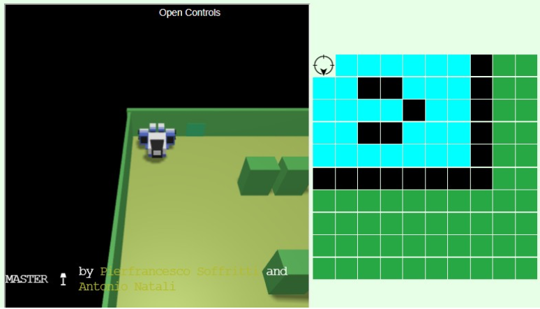
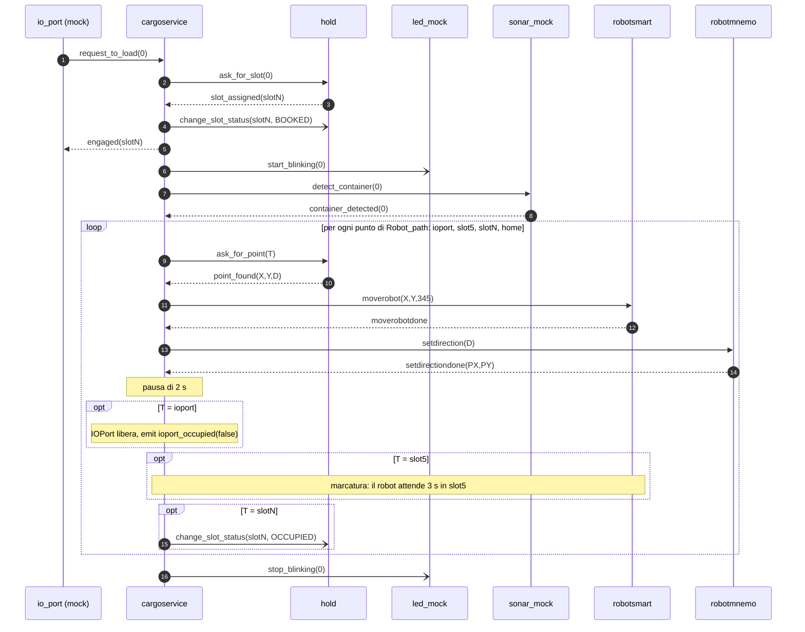

# Sprint1

## Indice

- [Goal dello Sprint](#goal-dello-sprint)
- [Analisi dei requisiti](#analisi-dei-requisiti)
- [Analisi del Problema](#analisi-del-problema)
- [Piano di Test](#piano-di-test)
- [Project](#project)
- [Testing](#testing)
- [Deployment](#deployment)
- [Piano di lavoro](#piano-di-lavoro)
- [Team di lavoro](#team-di-lavoro)

## Goal dello Sprint

Requisiti, macro-componenti, core business, scelta di QAK e interfacce di dominio sono nello [Sprint0](../UserDocs/sprint0.md). Lo Sprint0 ha assegnato a questo incremento il `cargoservice` (core business) e il `cargorobot`. Il ciclo di carico non è però eseguibile senza conoscere slot, posizioni e senza la marcatura nello `slot5`: lo Sprint1 realizza quindi anche la `hold` (entità di dominio del `cargoservice`, già formalizzata nello Sprint0), incapsulata in un attore Qak.

> **Prototipo eseguibile del core business del `cargoservice`**: gestione di una richiesta di carico proveniente dall'IOPort (esiti `retrylater`, rifiuto per hold piena, accettazione con slot riservato) e coordinamento dell'intero ciclo di carico — attesa del container, trasporto `IOPort → slot5 → slot riservato → home`, marcatura, aggiornamento della hold — superando i TestPlan definiti prima dello sviluppo.

Nonostante l'analisi e la realizzazione dell'IOPort (pushbutton e display), del sonar e del led siano assegnate allo Sprint2 (come specificato nello Sprint0), il `cargoservice` non è collaudabile senza interlocutori. Per questo, nello Sprint1, tali dispositivi compaiono solo come **attori mock** che rispettano il vocabolario di messaggi delle versioni definitive (Web GUI e Pico W), così da poterli sostituire senza toccare il codice del `cargoservice`.

Dei dispositivi entra quindi nello Sprint1 soltanto il **contratto di interazione con il cargoservice** (i messaggi scambiati), perché condiziona il core business ed è discusso, di conseguenza, nell'analisi del problema. L'analisi dei dispositivi veri e propri (misura di D, tempi, lampeggiamento del led, web-gui) e l'eventuale revisione di questo contratto spettano allo Sprint2.

## Analisi dei requisiti

Dei requisiti formalizzati nello Sprint0 (numerati qui R1–R9 per comodità) lo Sprint1 sviluppa il nucleo funzionale del servizio. Sono realizzati per intero il rifiuto della richiesta quando la hold è piena (R3), l'accettazione con individuazione e comunicazione dello slot riservato (R4) e il trasporto del container, con il cargorobot, dall'IOPort allo slot5 per la marcatura e poi allo slot riservato (R7), usando il robot virtuale fornito dal committente.

I dispositivi che lo Sprint2 realizzerà davvero sono **simulati con attori mock** che ne rispettano il vocabolario di messaggi: la richiesta di carico (R1) nasce dalla simulazione della pressione del pulsante, il led lampeggiante durante lo stato _engaged_ (R5) è un attore che si limita a segnalare "acceso/spento", e l'attesa del container entro il tempo prefissato (R6) è affidata a un sonar mock che risponde "container rilevato" oppure "tempo scaduto". La risposta `retrylater` (R2) è gestita quando l'IOPort è occupata, ma solo parzialmente: lo stato _Out of service_ non può ancora essere raggiunto, perché richiede la misura reale del sonar. Restano **rinviati allo Sprint2** il display con lo stato della hold e i messaggi `Service working` / `Out of service` (R8) e il rilevamento di `D > DFREE` per almeno 3 secondi (R9).

Il testo dei requisiti prevede che, durante la sosta nello `slot5`, un dispositivo _marker_ etichetti il container e segnali la fine dell'operazione. Nel confronto con il committente è emerso che **non occorre realizzare un attore dedicato** alla marcatura: è sufficiente che il robot (DDR) attenda nella posizione dello `slot5` per un tempo prefissato e poi riprenda il proprio percorso verso lo slot riservato. Dal punto di vista del sistema la marcatura è quindi una semplice attesa del robot, incapsulata nel `cargoservice`, e non introduce nuovi componenti né nuovi messaggi.

## Analisi del Problema

L'analisi parte dai requisiti del sottoinsieme (R1–R7) e dal modello dei macro-componenti dello Sprint0. Per ogni componente e per ogni interazione che compare nel prototipo motiviamo perché esiste e quale responsabilità ha; il risultato è formalizzato nel modello dell'analisi, da cui parte il Project.

Il testo dei requisiti lascia alcuni punti non specificati. Per ciascuno è stata adottata un'**assunzione**, da confermare con il committente. Se arriva una nuova richiesta mentre il sistema è già _engaged_ (Q1) si risponde `retrylater` solo se l'IOPort è occupata da un container (o il sistema è _Out of service_), come nei requisiti; negli altri casi la richiesta resta in coda ed è valutata al ritorno in _disengaged_, perché c'è un solo robot e un solo IOPort e quindi non è possibile gestire due carichi concorrenti. Gli slot sono assegnati nell'ordine `slot1 … slot4`, scegliendo il primo libero (Q2). "Riservare" uno slot (Q3) è inteso come una riserva esplicita: lo slot passa da `FREE` a `BOOKED` all'accettazione, a `OCCUPIED` al deposito del container, e torna `FREE` se il container non arriva entro il timeout del sonar. I 30 secondi di attesa del container (Q4) sono misurati, per ora, dal sonar mock, che risponde `sonar_timeout`. Se l'IOPort è occupata e la hold è piena contemporaneamente (Q5) prevale `retrylater`, perché le condizioni temporanee sono valutate per prime, nell'ordine in cui compaiono nel testo. Il comportamento da adottare quando il robot non riesce a completare un movimento (Q6) non è specificato dal committente e non è gestito nel prototipo. Infine, la marcatura nello `slot5` è modellata come attesa fissa del robot (nel prototipo 3 s), come indicato dal committente (si veda l'analisi dei requisiti); per lo stesso motivo il `cargoservice` non genera né registra alcun codice per il container (Q7): la hold memorizza soltanto lo stato di ciascuno slot.

Il virtual environment non offre primitive di presa/rilascio: il "prelievo" e il "deposito" del container sono modellati come _arrivo del robot_ nel punto corrispondente, più l'aggiornamento logico della hold.

### Il cargorobot: quale componente usare

Lo Sprint0 ha lasciato aperto quale componente fornito dal committente esprima il `cargorobot`.

| Componente              | Natura       | Livello offerto                       | Adeguatezza                                                        |
| ----------------------- | ------------ | ------------------------------------- | ------------------------------------------------------------------ |
| `RobotObj26`            | POJO         | Mosse di base                         | Non è un servizio; navigazione a nostro carico.                    |
| `VirtualRobot26` (WEnv) | Servizio     | Comandi cril a tempo (HTTP/WebSocket) | Troppo basso: percorsi e collisioni a nostro carico.               |
| `VirtuRobotService26`   | Servizio     | Comandi di base e passi               | Come sopra.                                                        |
| **`RobotSmart26`**      | Servizio QAK | **Destinazione come cella `(X,Y)`**   | **Scelto**: pianifica il percorso con A\* sulla mappa di contesto. |

`RobotSmart26` offre `moverobot(TARGETX, TARGETY, STEPTIME)` con reply `moverobotdone` / `moverobotfailed(PLANDONE, PLANTODO)` e `setrobotstate: setpos(X,Y,D)` per la posizione iniziale; gira nel Context `ctx_smartrobot` (porta 8020) sopra WEnv.

Per questo motivo la nostra analisi rileva che il `cargoservice` può usare `robotsmart` direttamente (`ExternalQActor`), **senza un attore `cargorobot` intermedio**: i requisiti chiedono solo di spostare il container tra punti noti, e un wrapper che inoltra `moverobot` non aggiungerebbe comportamento. È una **variazione rispetto al piano dello Sprint0**; il wrapper potrà essere introdotto se servirà un comportamento proprio del robot (es. movimento con/senza container), perché il `cargoservice` dipende solo dal contratto `moverobot`.

Tra i comandi esposti da `RobotSmart26` (`moverobot`, `setrobotstate`) non figurano primitive di presa o rilascio di un container. Di conseguenza il "prelievo" e il "deposito" sono modellati come arrivo del robot nel punto corrispondente (`ioport`, `slot5`, slot riservato), più l'aggiornamento logico della hold; il trasporto fisico non è osservabile oltre il movimento del robot.

### La mappa interna di RobotSmart26

`RobotSmart26` non riceve comandi di movimento elementari: riceve una cella di destinazione `(X,Y)` e calcola da sé il percorso. Per farlo mantiene una **mappa interna** dell'ambiente, una griglia di celle (nell'area 5x7 del WEnv fornito dal committente) in cui ogni cella è libera oppure è un ostacolo non attraversabile (pareti, ingombri dei container); il percorso è pianificato con A\* sulle sole celle libere.



Nella figura le celle azzurre sono libere, quelle nere sono ostacoli e quelle verdi sono esterne all'area di lavoro; la cella `(0,0)` è la posizione di partenza del robot, quella impostata dal `cargoservice` in `setup` con `setpos(0,0,down)`.

Nella griglia della figura la prima coordinata `X` indica la **riga** (da 0 a 4) e la seconda `Y` la **colonna** (da 0 a 6). Le celle usate dal ciclo di carico, definite in `HoldMap.json`, sono:

| Punto    | `(X,Y)` | Cella                                                             |
| -------- | ------- | ----------------------------------------------------------------- |
| `home`   | `(0,0)` | angolo di partenza del robot                                      |
| `ioport` | `(4,0)` | ultima riga, prima colonna                                        |
| `slot1`  | `(1,1)` | a sinistra del blocco di ostacoli della riga 1 (colonne 2–3)      |
| `slot2`  | `(1,4)` | a destra dello stesso blocco                                      |
| `slot3`  | `(3,1)` | a sinistra del blocco di ostacoli della riga 3 (colonne 2–3)      |
| `slot4`  | `(3,4)` | a destra dello stesso blocco                                      |
| `slot5`  | `(2,5)` | a destra dell'ostacolo della riga 2 (colonna 4), accanto al bordo |

Ogni punto è quindi una cella libera della mappa, adiacente agli ostacoli che rappresentano i container, e il robot può raggiungerlo percorrendo le celle azzurre.

La mappa ha tre conseguenze sul nostro modello:

1. **Le coordinate della hold sono coordinate della mappa.** I punti che la `hold` restituisce con `ask_for_point` (`ioport`, `slot5`, `slot1`–`slot4`, `home`, letti da `HoldMap.json`) sono celle della mappa di `RobotSmart26`; il `cargoservice` li passa a `moverobot` senza interpretarli.
2. **Il `cargoservice` non pianifica percorsi.** Evitare gli ostacoli e raggiungere la cella richiesta è responsabilità di `RobotSmart26`: il `cargoservice` si limita a elencare le tappe (`ioport`, `slot5`, slot riservato, `home`) e ad attendere `moverobotdone` a ogni tappa. Questo è un ulteriore motivo per cui un attore `cargorobot` intermedio non aggiungerebbe comportamento.
3. **La conoscenza della geometria resta nella hold.** Se la mappa o la disposizione degli slot cambiassero, andrebbe aggiornato solo `HoldMap.json`, senza toccare il `cargoservice`.

### Hold come attore qak

Nello Sprint0 `hold`, `slot` e `container` sono stati formalizzati come **entità di dominio** del `cargoservice` (interfacce Kotlin `IHold`, `ISlot`, `IContainer`). Nello Sprint1 la logica di dominio resta in un oggetto Kotlin (`Hold`, caricato da `HoldMap.json`), ma lo **incapsuliamo in un attore Qak `hold`** che ne è l'unico proprietario e che lo espone solo tramite messaggi. Le ragioni della scelta sono le seguenti:

1. **Costo computazionale:** un QActor non corrisponde a un thread del sistema operativo: è eseguito come coroutine Kotlin, simile a una goroutine di Go, cioè un'unità di esecuzione leggera schedulata su un piccolo insieme di thread condivisi dal Context. Con thread Java dedicati ogni componente avrebbe un proprio stack e un proprio costo di creazione e di context switch; con le coroutine più attori convivono nello stesso Context a costo molto inferiore, e l'attore `hold` può quindi essere un componente autonomo senza penalizzare il sistema.
2. **Accesso serializzato allo stato condiviso:** la hold è consultata e modificata da più interlocutori. Un attore elabora un messaggio alla volta: `ask_for_slot`, `ask_for_point` e `change_slot_status` sono quindi serializzati senza lock né `synchronized`, e lo stato (stato di ciascuno slot) non è mai condiviso fra thread. Questo è coerente con il vincolo di assenza di memoria condivisa fissato nello Sprint0.
3. **Interazione asincrona e personalizzata:** con un attore il `cargoservice` non invoca un metodo bloccante ma invia una _request_ e prosegue, ricevendo la _reply_ come messaggio (`slot_assigned`, `hold_full`, `point_found`, `point_not_found`); l'aggiornamento dello stato di uno slot (prenotazione, deposito, rilascio) è un _dispatch_ asincrono (`change_slot_status`) che non blocca il ciclo di carico. Possiamo inoltre definire il vocabolario di messaggi su misura per il dominio (ad esempio gli esiti `hold_full` e `point_not_found` come risposte esplicite) invece di esporre i metodi dell'oggetto.
4. **Trasparenza di locazione e riuso:** essendo identificata da un nome e da un Context, la `hold` è raggiungibile allo stesso modo da attori locali e da client remoti, e potrà essere spostata su un altro nodo senza modificare il `cargoservice`, che dipende solo dal contratto di messaggi.

La separazione fra attore e oggetto di dominio mantiene inoltre testabile la logica della hold in isolamento (si veda `HoldTestPlan`, definito nello Sprint0) e la tiene indipendente da Qak.

### Il problema della prenotazione dello slot

Il requisito dice che il sistema "individua uno slot libero e restituisce il nome dello slot riservato", ma non dice che cosa significhi "riservato" (Q3). Le interpretazioni possibili sono due:

1. **riserva implicita**: lo slot è marcato occupato solo al deposito, e fra accettazione e deposito nessun altro può riceverlo perché il `cargoservice` serializza i carichi (`Is_engaged`);
2. **riserva esplicita**: lo slot è segnato come riservato nella hold già all'accettazione, e va rilasciato, con un messaggio, se il container non arriva.

La riserva implicita lascia la hold senza traccia dello slot scelto finché il container non è depositato. Poiché il requisito parla di uno slot "riservato", la nostra analisi sceglie la **riserva esplicita**: ogni slot ha uno stato `FREE`, `BOOKED` (riservato, container non ancora depositato) oppure `OCCUPIED` (container depositato), e la hold è piena solo quando nessuno slot è `FREE`.

Per mantenere nella hold una netta separazione fra lettura e scrittura, il ciclo di vita dello slot è guidato dal `cargoservice`:

- `ask_for_slot` è **in sola lettura**: restituisce il primo slot `FREE` (o `hold_full`) senza modificarlo, quindi può essere ripetuto senza effetti sulla hold;
- `change_slot_status(SlotId, Status)` è **in sola scrittura** (dispatch): il `cargoservice` lo invia per prenotare lo slot (`BOOKED`, all'accettazione), per registrare il deposito (`OCCUPIED`) e per rilasciare lo slot se il sonar va in timeout (`FREE`).

Resta una breve finestra fra la reply `slot_assigned` e l'arrivo del dispatch `BOOKED` in cui un secondo `ask_for_slot` riceverebbe lo stesso slot. Nel sistema non può verificarsi perché il `cargoservice` è l'unico cliente di `ask_for_slot`, serializza i carichi (`Is_engaged`) e invia `BOOKED` prima di rispondere `engaged`; un cliente esterno che interroga la hold direttamente, come i test, può però osservarla.

### Il problema della concorrenza delle richieste

Il pulsante può essere premuto in qualsiasi momento, anche durante un carico (Q1), e un ciclo di carico dura decine di secondi. L'analisi evidenzia tre aspetti:

1. **Tempestività:** `retrylater` ha senso solo se arriva subito, perché dice al cliente di riprovare. Il `cargoservice` è un solo attore che elabora un messaggio alla volta: se la richiesta restasse in coda mentre il robot si muove, riceverebbe risposta solo al termine del carico in corso. Per i requisiti `retrylater` è però dovuto solo quando l'IOPort è occupata (o il sistema è _Out of service_): per questo la risposta immediata è necessaria solo nell'intervallo in cui il container è nell'IOPort, cioè dal rilevamento del sonar al prelievo da parte del robot. Fuori da tale intervallo i requisiti non prevedono `retrylater` e la richiesta resta in coda fino al ritorno in _disengaged_.
2. **Unicità:** Due richieste non devono mai essere accettate insieme. Poiché un attore elabora un messaggio alla volta, la valutazione e l'impostazione di `Is_engaged` sono atomiche.
3. **Copertura:** La risposta immediata deve essere possibile in ogni fase in cui l'IOPort può essere occupata e l'attesa può durare (attesa del punto e del robot fino al prelievo del container), non solo in una.

Le soluzioni possibili sono due: (a) il `cargoservice` tratta `request_to_load` come messaggio da servire subito negli stati di attesa in cui l'IOPort è occupata; (b) un attore separato riceve le richieste e risponde `retrylater`, delegando il carico a un altro attore. La nostra analisi rileva che (b) richiederebbe di duplicare `Is_engaged` fra due attori e di tenerli allineati con messaggi, con il rischio di risposte incoerenti; (a) mantiene lo stato in un solo attore, a costo di una gestione in più per ogni attesa. La scelta è (a); la sua realizzazione è descritta nel [Project](#project).

### Tempo e mock

`sonar_mock` risponde subito `container_detected` (flag `success = true`) o, con `success = false`, attende 30 s e risponde `sonar_timeout`.

### Il modello dell'analisi

Il risultato dell'analisi è formalizzato in un modello Qak. Il diagramma mostra i componenti e le interazioni individuate:

_TODO: inserire immagine generata del modello qak_

#### Vocabolario dei messaggi

I nomi sono allineati ai termini dei requisiti (rispetto al vocabolario provvisorio dello Sprint0: `request_to_load`, `engaged`, `rejected`, `retrylater`). Non esistono messaggi relativi alla marcatura, perché non è un'interazione fra attori (si veda l'analisi dei requisiti).

```text
Request request_to_load : request_to_load(ARG)
Reply   retrylater      : retrylater(ARG)  for request_to_load
Reply   rejected        : rejected(ARG)    for request_to_load
Reply   engaged         : engaged(SLOT)    for request_to_load

Request ask_for_slot    : ask_for_slot(ARG)
Reply   slot_assigned   : slot_assigned(ID)    for ask_for_slot
Reply   hold_full       : hold_full(ARG)       for ask_for_slot
Request ask_for_point   : ask_for_point(ID)
Reply   point_found     : point_found(X,Y)     for ask_for_point
Reply   point_not_found : point_not_found(ARG) for ask_for_point
Dispatch change_slot_status : change_slot_status(SlotId, Status)   // Status: FREE | BOOKED | OCCUPIED

Request detect_container   : detect_container(ARG)
Reply   container_detected : container_detected(ARG) for detect_container
Reply   sonar_timeout      : sonar_timeout(ARG)      for detect_container
Dispatch start_blinking : start_blinking(ARG)
Dispatch stop_blinking  : stop_blinking(ARG)

Dispatch setrobotstate  : setpos(X,Y,D)
Request  moverobot      : moverobot(TARGETX, TARGETY, STEPTIME)
Reply    moverobotdone  : moverobotdone(ARG)                  for moverobot
Reply    moverobotfailed: moverobotfailed(PLANDONE, PLANTODO) for moverobot

Event    ioport_occupied : io_port_occupied(ARG)
Dispatch press_button    : press_button(ARG)   // simulazione del pushbutton
```

Scelte sul tipo di messaggio: **Request/Reply** quando l'esito cambia il comportamento del chiamante; **Dispatch** per notifiche senza risposta; **Event** per `ioport_occupied`, che chiunque (in particolare il futuro display) potrà osservare.

#### Contesti e QActor

```text
Context ctx_cargoservice ip [host="localhost" port=8000]
Context ctx_smartrobot   ip [host="127.0.0.1" port=8020]

ExternalQActor robotsmart context ctx_smartrobot
```

Per ciascun attore QAK si indicano natura, responsabilità e interfaccia di messaggi; il seguente scheletro Qak ne riporta stati e transizioni essenziali (il codice completo, con log e contatori, è in `sprint1.qak`). Lo scheletro è quello del modello dell'analisi: il Project lo raffina con l'orientamento del robot tramite `robotmnemo` e con la direzione `D` restituita dalla hold (si veda [L'orientamento del robot: robotmnemo](#lorientamento-del-robot-robotmnemo)).

| QActor         | Natura                     | Responsabilità                                                                                                                | Riceve                                                                                                                       | Invia                                                                                                                                                                                                           |
| -------------- | -------------------------- | ----------------------------------------------------------------------------------------------------------------------------- | ---------------------------------------------------------------------------------------------------------------------------- | --------------------------------------------------------------------------------------------------------------------------------------------------------------------------------------------------------------- |
| `cargoservice` | Servizio (core business)   | Valuta le richieste, riserva lo slot, coordina il ciclo di carico (incluse l'attesa di marcatura e le richieste concorrenti)  | `request_to_load`; reply `slot_assigned`, `hold_full`, `point_found`, `container_detected`, `sonar_timeout`, `moverobotdone` | reply `engaged`, `rejected`, `retrylater`; `ask_for_slot`, `ask_for_point`, `change_slot_status`, `detect_container`, `moverobot`, `setrobotstate`, `start_blinking`, `stop_blinking`; evento `ioport_occupied` |
| `hold`         | Servizio (dominio)         | Possiede l'oggetto `Hold`: propone slot liberi (sola lettura), fornisce le coordinate dei punti, aggiorna lo stato degli slot | `ask_for_slot`, `ask_for_point`, `change_slot_status`                                                                        | reply `slot_assigned`, `hold_full`, `point_found`, `point_not_found`                                                                                                                                            |
| `io_port`      | Mock (Sprint2: web-gui)    | Trasforma `press_button` in `request_to_load` e riceve l'esito                                                                | `press_button`; reply `engaged`, `rejected`, `retrylater`                                                                    | `request_to_load`                                                                                                                                                                                               |
| `sonar_mock`   | Mock (Sprint2: sonar)      | Simula il rilevamento del container                                                                                           | `detect_container`                                                                                                           | reply `container_detected`, `sonar_timeout`                                                                                                                                                                     |
| `led_mock`     | Mock (Sprint2: led Pico W) | Segnala lo stato acceso/spento                                                                                                | `start_blinking`, `stop_blinking`                                                                                            | —                                                                                                                                                                                                               |

```text
QActor cargoservice context ctx_cargoservice {
    State setup initial      { forward robotsmart -m setrobotstate : setpos(0,0,down) } Goto disengaged
    State disengaged         { /* azzera lo stato; stop_blinking */ }
                             Transition t0 whenRequest request_to_load -> start_engage
    State start_engage       { } Goto retry_state if [# Io_port_occupied || System_out_of_service #] else ask_slot
    State retry_state        { replyTo request_to_load with retrylater } Goto disengaged
    State ask_slot           { /* Is_engaged = true */ request hold -m ask_for_slot } Goto wait_slot
    State wait_slot          { } Transition t1 whenReply slot_assigned -> engaged
                                               whenReply hold_full -> hold_full
    State hold_full          { /* Is_engaged = false */ replyTo request_to_load with rejected } Goto disengaged
    State engaged            { /* Robot_path = ioport, slot5, slot riservato, home */
                               forward hold -m change_slot_status(Slot_id, BOOKED);
                               replyTo request_to_load with engaged(Slot); forward led_mock -m start_blinking } Goto request_sonar
    State request_sonar      { request sonar_mock -m detect_container } Goto wait_sonar
    State wait_sonar         { } Transition t2 whenReply container_detected -> container_ready
                                               whenReply sonar_timeout -> sonar_timeout_state
    State container_ready    { /* Io_port_occupied = true */ } Goto check_target
    State sonar_timeout_state{ forward hold -m change_slot_status(Slot_id, FREE) } Goto disengaged
    State check_target       { } Goto loading_completed if [# Robot_path.isEmpty() #] else get_point
    State get_point          { /* Target = Robot_path.removeAt(0) */ request hold -m ask_for_point(Target) } Goto wait_point
    State wait_point         { } Transition t3 whenReply point_found -> move_robot
                                               whenRequest request_to_load and [# Io_port_occupied #] -> retry_wait_point
    State move_robot         { request robotsmart -m moverobot(X, Y, 345) } Goto wait_robot
    State wait_robot         { } Transition t4 whenReply moverobotdone -> moverobotdone
                                               whenRequest request_to_load and [# Io_port_occupied #] -> retry_wait_robot
    State moverobotdone      { /* Target == ioport: Io_port_occupied = false, emit ioport_occupied */ }
                             Goto marking_container if [# Target == "slot5" #] else check_reserved_slot
    State marking_container  { /* il robot attende in slot5 */ delay 3000 } Goto check_target
    State check_reserved_slot{ } Goto notify_hold if [# Target == Slot_id #] else check_target
    State notify_hold        { forward hold -m change_slot_status(Slot_id, OCCUPIED) } Goto check_target
    State loading_completed  { } Goto disengaged
    /* retry_wait_point, retry_wait_robot: replyTo request_to_load with retrylater, poi ritorno all'attesa */
}

QActor hold context ctx_cargoservice {
    [# val Hold = main.kotlin.Hold.Companion.createHoldFromConfig() #]
    State idle initial  { } Transition t0 whenRequest ask_for_slot -> get_slot
                                          whenRequest ask_for_point -> get_point
                                          whenMsg change_slot_status -> update_map
    State get_slot      { /* sola lettura, Hold.getFreeSlot(): slot_assigned(Id) oppure hold_full(0) */ } Goto idle
    State get_point     { /* Hold.getPoint(Id): point_found(X,Y) oppure point_not_found(0) */ } Goto idle
    State update_map    { /* Hold.changeStatus(Slot, Status) */ } Goto idle
}

QActor io_port context ctx_cargoservice {          // mock del pushbutton
    State idle initial  { } Transition t0 whenMsg press_button -> handle_press
                                          whenReply engaged -> accepted
                                          whenReply rejected -> rejected_state
                                          whenReply retrylater -> retry_state
    State handle_press  { request cargoservice -m request_to_load(0) } Goto idle
    /* accepted, rejected_state, retry_state: aggiornano i contatori e stampano l'esito */
}

QActor sonar_mock context ctx_cargoservice {
    [# val Timeout = 30000L; var success = true #]
    State idle initial  { } Transition t0 whenRequest detect_container -> measuring
    State measuring     { /* success: replyTo detect_container with container_detected */ }
                        Goto idle if [# success #] else wait_timeout
    State wait_timeout  { } Transition t1 whenTimeVar Timeout -> handle_timeout
    State handle_timeout{ replyTo detect_container with sonar_timeout } Goto idle
}

QActor led_mock context ctx_cargoservice {
    State off initial   { } Transition t0 whenMsg start_blinking -> on
                                          whenMsg stop_blinking -> off
    State on            { } Transition t1 whenMsg stop_blinking -> off
                                          whenMsg start_blinking -> on
}
```

## Piano di Test

Il piano è stato definito prima dell'implementazione sul modello dell'analisi e indica che cosa va dimostrato; i test automatici che lo realizzano sono descritti nella sezione [Testing](#testing). Le verifiche avvengono dall'esterno del sistema: si inviano request e dispatch al Context `ctx_cargoservice` (TCP, porta 8000) e si controllano identificatore e payload delle reply.

Verifiche sui singoli componenti:

1. La hold conosce le coordinate di tutti i punti necessari al ciclo di carico (`ioport`, `slot5`, `home`, `slot1`–`slot4`) e segnala in modo esplicito una posizione inesistente (R7).
2. A ogni richiesta di slot la hold risponde con uno slot valido (`slot1`–`slot4`) oppure con "hold piena", qualunque sia il suo stato; la richiesta è in sola lettura e non modifica la hold (R3, R4).
3. Il sonar segnala la presenza del container (R6).

Verifiche sul comportamento del `cargoservice` e della hold in uso reale:

4. Alla richiesta di carico il `cargoservice` risponde con uno solo degli esiti previsti dal committente: accettazione con un nome di slot valido, `retrylater` oppure rifiuto (R1–R4).
5. Partendo da una hold vuota, quattro slot percorrono il ciclo `FREE` → `BOOKED` → `OCCUPIED`: nessuno viene proposto due volte, uno slot prenotato non è più proposto e, a hold piena (tutti `OCCUPIED`), la richiesta di slot dà "hold piena" (R3, R4).
6. Il ciclo di carico completo, con il robot virtuale, si conclude con il container registrato nella hold: dopo la pressione del pulsante e l'attesa del ciclo, lo slot libero cambia (R1, R4, R7).
7. Con la hold piena la richiesta di carico non modifica la hold e viene rifiutata (R3).
8. Una nuova richiesta mentre l'IOPort è occupata dal container del carico in corso riceve `retrylater`, mentre la prima è stata accettata con lo stesso slot che la hold indicava come libero (R2, Q1).
9. Ciclo completo con il vero `io_port`: quattro pressioni del pulsante, ciascuna seguita dall'attesa di un ciclo di carico, riempiono la hold; la quinta pressione trova la hold piena e viene rifiutata, senza modificare la hold (R1, R3, R4, R7).

La hold non permette di distinguere dall'esterno uno slot `BOOKED` da uno `OCCUPIED`: `ask_for_slot` non propone né l'uno né l'altro. I test end-to-end non possono quindi attendere il deposito sondando la hold, e usano un'attesa fissa per il ciclo di carico; il passaggio a `OCCUPIED` è verificabile direttamente solo in console (`CARGOSERVICE | Container deployed`).

I test non coperti dal piano in questo sprint sono: il timeout dell'attesa del container (il sonar mock risponde sempre "container rilevato"), `retrylater` per _Out of service_ (stato non ancora raggiungibile, R9), il comportamento del led (osservabile solo in console) e il percorso del robot (osservabile nella GUI di RobotSmart26 e, indirettamente, dall'esito del ciclo completo).

## Project

Il Project parte dal [modello dell'analisi](#il-modello-dellanalisi) e ne produce una specializzazione eseguibile: `sprint1.qak`. Il vocabolario dei messaggi è quello del modello dell'analisi, esteso nel Project con l'interazione con `robotmnemo` (`setdirection`, `setdirectiondone`) e con la direzione `D` in `point_found(X,Y,D)`, descritte nella sezione [L'orientamento del robot: robotmnemo](#lorientamento-del-robot-robotmnemo).

### Il cargoservice

**Stato interno:** `Is_engaged` (richiesta accettata, carico non terminato), `Io_port_occupied` (container rilevato e non ancora prelevato), `System_out_of_service` (mai impostato in Sprint1), `Slot_id`, `Robot_path` (punti da raggiungere: `ioport`, `slot5`, slot riservato, `home`), `Target` (punto in corso di raggiungimento) e `Direction` (direzione che il robot deve assumere in `Target`, fornita dalla hold).



| Fase                 | Stati QAK                                                                                                  | Comportamento                                                                                                                                                                                                                                      |
| -------------------- | ---------------------------------------------------------------------------------------------------------- | -------------------------------------------------------------------------------------------------------------------------------------------------------------------------------------------------------------------------------------------------- |
| Avvio e riposo       | `setup`, `disengaged`                                                                                      | `setup` allinea il robot (`setpos(0,0,down)`); `disengaged` azzera `Is_engaged`, invia `stop_blinking` al led (al primo avvio il runtime segnala che il messaggio non è consegnabile, ma il led parte comunque spento), attende `request_to_load`. |
| Valutazione          | `start_engage`, `retry_state`                                                                              | Se `Io_port_occupied \|\| System_out_of_service` → `retrylater(0)`.                                                                                                                                                                                |
| Prenotazione         | `ask_slot`, `wait_slot`, `hold_full`, `engaged`                                                            | Pone `Is_engaged`, chiede lo slot (sola lettura); `hold_full` → `rejected(0)`; `slot_assigned` → costruisce `Robot_path`, prenota lo slot con `change_slot_status(slot, BOOKED)`, risponde `engaged(slot)`, avvia il led.                          |
| Attesa container     | `request_sonar`, `wait_sonar`, `container_ready`, `sonar_timeout_state`                                    | `sonar_timeout` → libera lo slot con `change_slot_status(slot, FREE)` e torna a `disengaged` (che azzera lo stato e spegne il led); `container_detected` → `Io_port_occupied = true`.                                                              |
| Trasporto            | `check_target`, `get_point`, `wait_point`, `move_robot`, `wait_robot`, `moverobotdone`, `setdirectiondone` | Prossimo punto di `Robot_path` → coordinate e direzione dalla hold → `moverobot` → attesa reply → `setdirection` a `robotmnemo` → pausa di 2 s. Raggiunto `ioport`, al termine della pausa libera l'IOPort ed emette l'evento.                     |
| Marcatura e deposito | `marking_container`, `check_reserved_slot`, `notify_hold`                                                  | A `slot5` il robot attende 3 s (`delay`); allo slot riservato si invia `change_slot_status(slot, OCCUPIED)`.                                                                                                                                       |
| Chiusura             | `loading_completed`                                                                                        | `Robot_path` vuoto (robot in `home`): torna a `disengaged`, che azzera lo stato e spegne il led.                                                                                                                                                   |

**Marcatura nello `slot5`**: La marcatura non è affidata a un attore dedicato: quando il robot è arrivato in `slot5` (`moverobotdone`) e ha assunto la direzione richiesta (`setdirectiondone`), il `cargoservice` entra in `marking_container`, dove con `delay 3000` lascia il DDR fermo in `slot5` per 3 s; poi riprende il percorso (`check_target`) verso lo slot riservato. Come richiesto dal committente, il `cargoservice` non gestisce alcun codice del marker: l'unica informazione che la hold riceve su un container è lo stato `OCCUPIED` dello slot, inviato al deposito. Poiché durante il `delay` il `cargoservice` non consuma messaggi, le `request_to_load` che arrivano in quei 3 s restano in coda: l'IOPort è già libera, quindi non ricevono `retrylater` e sono valutate al ritorno in `disengaged`.

**Realizzazione della risposta immediata**: Fra le soluzioni individuate nell'analisi, gli stati di attesa in cui l'IOPort può essere occupata (`wait_point`, `wait_robot`) hanno, oltre alla transizione sulla reply attesa, la transizione `whenRequest request_to_load` con guardia `Io_port_occupied` verso uno stato `retry_wait_*` che risponde subito `retrylater(0)` e torna all'attesa. Se la guardia è falsa la richiesta non viene consumata: il runtime Qak la tiene nella coda dei messaggi non attesi e la valuta al ritorno in `disengaged`. Per questo `wait_sonar` (container non ancora rilevato, IOPort libera) e `wait_slot` non hanno transizioni sulla richiesta. Poiché un attore elabora un messaggio alla volta, controllo e impostazione di `Is_engaged` sono atomici: due richieste non possono essere accettate insieme.

**Nota**: nello Sprint1 `retrylater` è raggiungibile solo per `Io_port_occupied` (dal rilevamento del container al prelievo da parte del robot); il ramo `System_out_of_service` diventerà raggiungibile con il sonar reale. In `start_engage` non compare `Is_engaged`: lì il `cargoservice` è sempre in `disengaged`.

### L'orientamento del robot: robotmnemo

_//TODO: da riscrivere meglio il paragrafo e capire se va messo qui o nell'analisi_

`moverobot(TARGETX, TARGETY, STEPTIME)` porta `robotsmart` in una cella ma non ha un parametro per la direzione con cui il robot vi arriva. La hold associa invece a ogni punto una direzione `D` (campo `direction` di `HoldMap.json`: ad esempio `down` per `ioport` e `home`, `right` o `left` per gli slot, a seconda del lato del blocco di ostacoli). Per fare assumere al DDR questa direzione il Project usa un secondo attore, `robotmnemo`, che gira nello stesso Context `ctx_smartrobot` (porta 8020) ed è dichiarato come `ExternalQActor`, come `robotsmart`:

```text
Context ctx_cargoservice ip [host="localhost" port=8000]
Context ctx_smartrobot   ip [host="127.0.0.1" port=8020]

ExternalQActor robotsmart context ctx_smartrobot
ExternalQActor robotmnemo context ctx_smartrobot
```

Il contratto di interazione aggiunto al vocabolario dei messaggi è:

```text
Request setdirection     : dir(D)
Reply   setdirectiondone : pos(PX,PY) for setdirection
```

Inoltre `point_found` trasporta anche la direzione, `point_found(X,Y,D)`, e il `cargoservice` la memorizza in `Direction` quando riceve le coordinate del punto (`move_robot`).

**Flusso.** Dopo ogni `moverobotdone` il `cargoservice` entra in `moverobotdone`, dove invia `setdirection(Direction)` a `robotmnemo`, e attende `setdirectiondone` (transizione `t10`). Poi entra in `setdirectiondone`: stampa la direzione, attende 2 s e, se il punto è `ioport`, libera l'IOPort (`Io_port_occupied = false`) ed emette l'evento `ioport_occupied`; infine prosegue verso `marking_container` (punto `slot5`), `notify_hold` (slot riservato) o `check_target`. Se `Direction` è vuota, la richiesta a `robotmnemo` viene saltata e `wait_robot` passa direttamente a `setdirectiondone`.

L'orientamento avviene a ogni tappa del percorso (`ioport`, `slot5`, slot riservato, `home`). In particolare, al ritorno in `home` il robot riprende la direzione `down` impostata all'avvio con `setpos(0,0,down)`, così il ciclo successivo parte dalle stesse condizioni iniziali.

**Limite noto.** Negli stati `moverobotdone` (attesa di `setdirectiondone`) e `setdirectiondone` (pausa di 2 s) il `cargoservice` non ha transizioni sulla `request_to_load`. Se il punto è `ioport`, una richiesta che arriva in questo intervallo trova l'IOPort ancora occupata ma non riceve `retrylater` subito: resta in coda e, poiché l'IOPort viene liberata al termine della pausa, è valutata solo al ritorno in `disengaged`.

### Gli altri attori

Le motivazioni della loro esistenza sono nell'analisi del problema; qui ne riportiamo il comportamento.

- **`hold`**: incapsula l'oggetto `Hold` (caricato da `HoldMap.json`). `ask_for_slot` → primo slot `FREE` o `hold_full`, in sola lettura; `ask_for_point` → `point_found(X,Y,D)` (coordinate e direzione del punto, da `HoldMap.json`) o `point_not_found`; `change_slot_status(SlotId, Status)` → `Hold.changeStatus` (lo stato diventa `FREE`, `BOOKED` o `OCCUPIED`; uno stato o uno slot sconosciuto lascia la hold invariata) e stampa `HOLD | slotN changed status to <Status>`.
- **`io_port`, `sonar_mock`, `led_mock`**: mock descritti nell'analisi; `io_port` trasforma `press_button` in `request_to_load` e conta gli esiti ricevuti.

## Testing

Tutti i test sono nella classe [`Sprint1Test.java`](../project_Cargoservice/cargoservice_sprint1/src/test/java/Sprint1Test.java) (JUnit 4). Ogni test apre una connessione TCP verso `localhost:8000` (`@Before`), la chiude al termine (`@After`) e dialoga direttamente con gli attori del Context `ctx_cargoservice`. I test `test_holdCoordinate`, `test_holdRispostaValidaIndipendentementeDalloStato` e `test_sonarMock` verificano il contratto dei singoli attori (`hold`, `sonar_mock`); gli altri verificano il `cargoservice` con il sistema completo, e `test_caricamentoIntegratoConRobot`, `test_richiestaDuranteCaricamento_RetryLater` e `test_cicloCompleto_QuattroCarichiEQuintoRifiutato` richiedono il robot virtuale.

**Avvertenze:** alcuni test dipendono dallo stato condiviso della hold: `test_holdDaVuotoAPieno` la riempie, `test_richiestaRifiutataConHoldPieno` presuppone che sia piena, `test_cargoserviceContratto`, `test_caricamentoIntegratoConRobot` e `test_richiestaDuranteCaricamento_RetryLater` avviano un vero carico se la richiesta è accettata, `test_cicloCompleto_QuattroCarichiEQuintoRifiutato` parte da una hold vuota e la riempie. La classe non impone un ordine di esecuzione, quindi questi test vanno lanciati **singolarmente su un sistema riavviato**.

`ask_for_slot` è in sola lettura. Poiché la prenotazione (`BOOKED`) è inviata dal `cargoservice` con `change_slot_status`, la funzione `slot()` può essere usata come sonda sulla hold senza consumare slot. Non distingue però uno slot `BOOKED` da uno `OCCUPIED` (nessuno dei due è più proposto): i test che devono attendere la fine di un ciclo di carico usano quindi un'attesa fissa, `CYCLE_WAIT_MS` (50 s), e il passaggio a `OCCUPIED` si controlla in console (`CARGOSERVICE | Container deployed`).

### Funzioni di supporto

I test usano alcune funzioni ausiliarie che nascondono il formato dei messaggi:

```java
private IApplMessage request(String actor, String id, String payload) throws Exception {
    return request(actor, id, payload, REQUEST_TIMEOUT_MS);   // 12 s
}

private IApplMessage request(String actor, String id, String payload, int timeoutMs) throws Exception {
    IApplMessage req = CommUtils.buildRequest(SENDER, id, payload, actor);
    IApplMessage reply = conn.request(req, timeoutMs);
    assertNotNull("Reply mancante: " + req, reply);
    return reply;
}

private void dispatch(String actor, String id, String payload) throws Exception {
    conn.forward(CommUtils.buildDispatch(SENDER, id, payload, actor));
}

private IApplMessage slot() throws Exception {
    return request("hold", "ask_for_slot", "ask_for_slot(0)");
}

private static void isReply(IApplMessage reply, String id) {
    assertEquals("Reply inattesa: " + reply, id, reply.msgId());
}

private static void validSlot(String value) {
    assertTrue("Slot non valido: " + value,
            Arrays.asList("slot1", "slot2", "slot3", "slot4").contains(value));
}

private static void validSlotOrFull(IApplMessage reply) {
    if ("slot_assigned".equals(reply.msgId())) validSlot(oneArg(reply));
    else { isReply(reply, "hold_full"); assertEquals("0", oneArg(reply)); }
}

private void setSlotStatus(String slotId, String status) throws Exception {
    // dispatch verso hold, come fa il cargoservice; l'attesa evita corse con la request successiva
    dispatch("hold", "change_slot_status", "change_slot_status(" + slotId + "," + status + ")");
    TimeUnit.MILLISECONDS.sleep(300);
}

// durata massima attesa per un ciclo di carico completo (IOPort -> slot5 -> slot -> home)
private static final int CYCLE_WAIT_MS = 50000;
```

`request` invia una Request e attende la Reply (per default fino a 12 s; l'overload con `timeoutMs` consente attese più lunghe), `dispatch` invia un messaggio senza risposta, `slot()` chiede uno slot alla hold (in sola lettura), `isReply` controlla l'identificatore della reply, `validSlot` e `validSlotOrFull` controllano che il payload sia uno slot valido (o la risposta "hold piena"), `setSlotStatus` simula il `cargoservice` inviando `change_slot_status` alla hold. Le funzioni `args` e `oneArg` (non riportate) estraggono dal payload `nome(a,b,…)` i singoli argomenti.

### test_holdCoordinate

Chiede alla hold i punti usati dal ciclo di carico e verifica che la reply `point_found(X,Y,D)` abbia tre argomenti e che le coordinate `X` e `Y` siano numeri finiti; verifica inoltre che un punto sconosciuto produca `point_not_found(0)`. Garantisce che il `cargoservice` possa sempre ottenere dalla hold le destinazioni da passare al robot.

```java
@Test(timeout = 30000)
public void test_holdCoordinate() throws Exception {
    for (String point : Arrays.asList("ioport", "slot5", "home",
            "slot1", "slot2", "slot3", "slot4")) {
        IApplMessage reply = request("hold", "ask_for_point", "ask_for_point(" + point + ")");
        isReply(reply, "point_found");
        String[] xy = args(reply);
        assertEquals("Coordinate di " + point, 3, xy.length);
        assertTrue("X non finita", Double.isFinite(Double.parseDouble(xy[0])));
        assertTrue("Y non finita", Double.isFinite(Double.parseDouble(xy[1])));
    }
    IApplMessage missing = request("hold", "ask_for_point", "ask_for_point(punto_inesistente)");
    isReply(missing, "point_not_found");
    assertEquals("0", oneArg(missing));
}
```

### test_holdRispostaValidaIndipendentementeDalloStato

Chiede uno slot alla hold e verifica che la risposta sia valida qualunque sia lo stato della hold: `slot_assigned` con uno slot da `slot1` a `slot4`, oppure `hold_full(0)`. Il test non presuppone che la hold sia vuota, perché un altro test può averla riempita. La richiesta è in sola lettura, quindi non lascia effetti sulla hold.

```java
@Test(timeout = 20000)
public void test_holdRispostaValidaIndipendentementeDalloStato() throws Exception {
    validSlotOrFull(slot());
}
```

### test_sonarMock

Invia `detect_container(0)` al sonar mock e verifica la risposta `container_detected(0)`. Dimostra il contratto del sonar (richiesta di rilevazione e reply) che il sonar reale dello Sprint2 dovrà rispettare.

```java
@Test(timeout = 20000)
public void test_sonarMock() throws Exception {
    IApplMessage reply = request("sonar_mock", "detect_container", "detect_container(0)");
    isReply(reply, "container_detected");
    assertEquals("0", oneArg(reply));
}
```

### test_cargoserviceContratto

Invia una `request_to_load(0)` al `cargoservice` e verifica che la reply sia una di quelle previste dai requisiti: `engaged` con uno slot valido, oppure `retrylater(0)` o `rejected(0)`. Verifica il contratto verso l'IOPort, non l'esito del carico. Se la richiesta è accettata avvia davvero il movimento del robot, per cui va eseguito su un sistema a riposo.

```java
@Test(timeout = 30000)
public void test_cargoserviceContratto() throws Exception {
    IApplMessage reply = request("cargoservice", "request_to_load", "request_to_load(0)");
    String id = reply.msgId();
    assertTrue("Reply non prevista: " + reply,
            Arrays.asList("engaged", "retrylater", "rejected").contains(id));
    if ("engaged".equals(id)) validSlot(oneArg(reply));
    else assertEquals("0", oneArg(reply));
}
```

### test_holdDaVuotoAPieno

Riempie la hold dall'esterno riproducendo il ciclo di vita di uno slot, come fa il `cargoservice`. Per quattro volte: chiede uno slot (valido e mai assegnato prima, perché la hold parte vuota); lo richiede una seconda volta e verifica che sia lo stesso, cioè che `ask_for_slot` sia in sola lettura; lo prenota con `change_slot_status(slot, BOOKED)` e verifica che non venga più proposto; infine lo porta a `OCCUPIED`, come al deposito del container. Alla fine verifica che la richiesta successiva dia `hold_full(0)`, cioè che la hold sia piena quando tutti gli slot sono `OCCUPIED`. È un test **distruttivo**: va eseguito su un sistema appena avviato, con hold vuota.

```java
@Test(timeout = 60000)
public void test_holdDaVuotoAPieno() throws Exception {
    Set<String> used = new HashSet<>();

    for (int i = 1; i <= 4; i++) {
        IApplMessage free = slot();
        isReply(free, "slot_assigned");             // la hold parte vuota
        String assigned = oneArg(free);
        validSlot(assigned);
        assertTrue("Slot assegnato due volte: " + assigned, used.add(assigned));

        // ask_for_slot non modifica la hold: ripetuto, propone lo stesso slot
        assertEquals("ask_for_slot deve essere in sola lettura", assigned, oneArg(slot()));

        // prenotazione: lo slot non è più proposto
        setSlotStatus(assigned, "BOOKED");
        IApplMessage afterBooking = slot();
        validSlotOrFull(afterBooking);
        if ("slot_assigned".equals(afterBooking.msgId())) {
            assertFalse("Slot BOOKED ancora proposto: " + assigned,
                    assigned.equals(oneArg(afterBooking)));
        }

        // deposito del container: lo slot prenotato diventa OCCUPIED
        setSlotStatus(assigned, "OCCUPIED");
    }
    assertEquals(4, used.size());
    IApplMessage full = slot();
    isReply(full, "hold_full");
    assertEquals("0", oneArg(full));
}
```

Con `ask_for_slot` il test non può distinguere `BOOKED` da `OCCUPIED`: verifica che la sequenza completa porti a `hold_full` e che ogni slot sia assegnato una sola volta.

### test_caricamentoIntegratoConRobot

Test end-to-end del ciclo di carico. Verifica che la hold abbia uno slot libero (sarà quello riservato dal `cargoservice`), simula la pressione del pulsante con `press_button(0)` a `io_port` e attende `CYCLE_WAIT_MS` (50 s), il tempo di un ciclo di carico. Poi richiede di nuovo uno slot: lo slot iniziale non deve più essere proposto, perché prenotato o occupato dal `cargoservice`, oppure la hold deve essere piena. Coinvolge `io_port`, `cargoservice`, `hold`, `sonar_mock`, `led_mock` e il robot virtuale.

Poiché `ask_for_slot` non distingue `BOOKED` da `OCCUPIED`, il test prova che lo slot è stato riservato e che il ciclo ha avuto il tempo di concludersi, non il deposito: questo si controlla in console (`CARGOSERVICE | Container deployed`).

```java
@Test(timeout = 150000)
public void test_caricamentoIntegratoConRobot() throws Exception {
    // 1. la hold ha uno slot libero (sola lettura): sarà quello riservato dal cargoservice
    IApplMessage before = slot();
    isReply(before, "slot_assigned");
    String initialFree = oneArg(before);
    validSlot(initialFree);

    // 2. simula la pressione del pulsante dell'IOPort
    dispatch("io_port", "press_button", "press_button(0)");

    // 3. attende la fine del ciclo di carico con un tempo fisso
    TimeUnit.MILLISECONDS.sleep(CYCLE_WAIT_MS);

    // 4. lo slot iniziale non è più libero (prenotato/occupato) oppure la hold è piena
    IApplMessage after = slot();
    validSlotOrFull(after);
    boolean containerLoaded = "hold_full".equals(after.msgId())
            || !initialFree.equals(oneArg(after));
    assertTrue("ERRORE: lo slot " + initialFree + " risulta ancora libero dopo "
            + CYCLE_WAIT_MS / 1000 + " secondi. "
            + "Controllare le console di cargoservice e robotsmart.", containerLoaded);
}
```

### test_richiestaRifiutataConHoldPieno

Con la hold già piena (precondizione verificata dal test stesso) simula una nuova pressione del pulsante e dopo 2 s verifica che la hold sia ancora piena. La richiesta attraversa il vero `io_port`; l'arrivo di `rejected` all'IOPort è visibile nella console (`IOPORT_MOCK | Request rejected`).

```java
@Test(timeout = 20000)
public void test_richiestaRifiutataConHoldPieno() throws Exception {
    // precondizione: tutti e quattro gli slot sono occupati
    IApplMessage before = slot();
    isReply(before, "hold_full");
    assertEquals("0", oneArg(before));

    // la richiesta attraversa il vero QActor io_port
    dispatch("io_port", "press_button", "press_button(0)");

    // la hold deve restare piena
    Thread.sleep(2000);
    IApplMessage after = slot();
    isReply(after, "hold_full");
    assertEquals("0", oneArg(after));
}
```

### test_richiestaDuranteCaricamento_RetryLater

Verifica la gestione delle richieste concorrenti (Q1). La prima `request_to_load` deve ricevere `engaged` con lo stesso slot che la hold indicava come libero; dopo 0,5 s, mentre l'IOPort è ancora occupata dal container (il robot non l'ha ancora prelevato), la seconda deve ricevere subito `retrylater(0)`, senza attendere la fine del carico. Richiede il robot virtuale.

```java
@Test(timeout = 60000)
public void test_richiestaDuranteCaricamento_RetryLater() throws Exception {
    // 1. c'è almeno uno slot libero (sola lettura): sarà quello assegnato alla prima richiesta
    IApplMessage before = slot();
    isReply(before, "slot_assigned");
    String initialSlot = oneArg(before);
    validSlot(initialSlot);

    // 2. prima richiesta: accettata, con lo slot indicato dalla hold
    IApplMessage firstReply = request("cargoservice", "request_to_load", "request_to_load(0)");
    isReply(firstReply, "engaged");
    String assignedSlot = oneArg(firstReply);
    validSlot(assignedSlot);
    assertEquals("Lo slot assegnato non corrisponde a quello disponibile",
            initialSlot, assignedSlot);

    // 3. l'IOPort resta occupata finché il robot non preleva il container
    TimeUnit.MILLISECONDS.sleep(500);

    // 4. seconda richiesta con l'IOPort occupata: retrylater
    IApplMessage secondReply = request("cargoservice", "request_to_load", "request_to_load(0)");
    isReply(secondReply, "retrylater");
    assertEquals("0", oneArg(secondReply));
}
```

### test_cicloCompleto_QuattroCarichiEQuintoRifiutato

Test end-to-end del funzionamento complessivo: cinque pressioni del pulsante (`press_button`) su una hold inizialmente vuota. Dopo ognuna delle prime quattro il test attende `CYCLE_WAIT_MS` (50 s), il tempo di un ciclo di carico, senza sondare la hold: una pressione mentre l'IOPort è occupata riceverebbe `retrylater` e `io_port` la scarterebbe, quindi la pressione successiva parte solo a ciclo concluso. Dopo il quarto carico verifica che la hold sia piena (`hold_full(0)`: se non lo è, di solito l'attesa è troppo corta), preme il pulsante una quinta volta, attende altri `CYCLE_WAIT_MS` (il tempo che la richiesta sia valutata) e verifica che la hold sia ancora piena.

`press_button` è un dispatch, quindi il test non riceve la reply: gli effetti sono verificati sulla hold, mentre il rifiuto della quinta richiesta è visibile nella console QAK (`IOPORT_MOCK | Request rejected`, `IOPORT_MOCK | Hold is full`). Richiede il robot virtuale ed è **distruttivo**: va eseguito su un sistema appena avviato. Il tempo massimo del test è circa 5 × `CYCLE_WAIT_MS`, entro il timeout di 420 s.

```java
@Test(timeout = 420000)
public void test_cicloCompleto_QuattroCarichiEQuintoRifiutato() throws Exception {
    for (int i = 1; i <= 4; i++) {
        dispatch("io_port", "press_button", "press_button(0)");
        TimeUnit.MILLISECONDS.sleep(CYCLE_WAIT_MS);   // ciclo di carico concluso
    }

    // la hold è piena
    IApplMessage full = slot();
    isReply(full, "hold_full");
    assertEquals("0", oneArg(full));

    // quinta pressione: rifiutata, la hold non cambia
    dispatch("io_port", "press_button", "press_button(0)");
    TimeUnit.MILLISECONDS.sleep(CYCLE_WAIT_MS);
    IApplMessage after = slot();
    isReply(after, "hold_full");
    assertEquals("0", oneArg(after));
}
```

### Esiti dei test

| Test                                                 | Requisiti      | Esito        |
| ---------------------------------------------------- | -------------- | ------------ |
| `test_holdCoordinate`                                | R7             | **Superato** |
| `test_holdRispostaValidaIndipendentementeDalloStato` | R3, R4         | **Superato** |
| `test_sonarMock`                                     | R6             | **Superato** |
| `test_cargoserviceContratto`                         | R1–R4          | **Superato** |
| `test_holdDaVuotoAPieno`                             | R3, R4         | **Superato** |
| `test_caricamentoIntegratoConRobot`                  | R1, R4, R7     | **Superato** |
| `test_richiestaRifiutataConHoldPieno`                | R3             | **Superato** |
| `test_richiestaDuranteCaricamento_RetryLater`        | R2             | **Superato** |
| `test_cicloCompleto_QuattroCarichiEQuintoRifiutato`  | R1, R3, R4, R7 | **Superato** |

## Deployment

1. **Ambiente del robot** (fornito dal committente): `robotsmart26.yaml` (Docker) avvia broker MQTT, `wenv` (8090), GUI con mappa di contesto `robotoutgui25` (8085) e `robotsmart26` (8020, Context `ctx_smartrobot`, a cui appartengono `robotsmart` e `robotmnemo`). Serve per i test che utilizzano il DDR e per avviare il Context `ctx_cargoservice`.
2. **`cargoservice`**: Context `ctx_cargoservice` sulla porta 8000.

Dalla cartella `project_Cargoservice/cargoservice_sprint1`:

```bash
docker compose -f robotsmart26.yaml up      # ambiente del robot
./gradlew run                              # Context cargoservice (Windows: gradlew.bat run)
./gradlew test --tests "test.java.Sprint1Test.test_cicloCompleto_QuattroCarichiEQuintoRifiutato"
```

Il codice in `src/it/unibo` è generato dalla software factory QAK da `sprint1.qak`.

## Piano di lavoro

1. Analisi dei requisiti del sottoinsieme (R1–R9, assunzioni Q1–Q7).
2. Analisi del problema: scelta di RobotSmart26, ruolo della hold come attore, prenotazione esplicita dello slot (`FREE` → `BOOKED` → `OCCUPIED`), gestione delle richieste concorrenti, analisi delle interazioni e dei messaggi.
3. Formalizzazione del risultato dell'analisi in un modello Qak (messaggi, Context e QActor).
4. Definizione del TestPlan (`Sprint1Test`) prima del codice.
5. Project: specializzazione del modello dell'analisi in `sprint1.qak` e dominio Kotlin della hold.
6. Test end-to-end con il robot virtuale e revisione del modello.

**Goal dello Sprint2:** IOPort come Web GUI (pushbutton, display) e sonar/led su Pico W al posto dei mock; analisi dei dispositivi e delle loro interazioni con il `cargoservice` (con l'eventuale revisione del contratto di messaggi usato dai mock); misura `D > DFREE` e stato _Out of service_ (R8, R9) con l'obiettivo di chiudere i punti rimasti in sospeso.

## Team di lavoro

**Francesco Cenerini, Niccolò Leoncini, Pietro Milo Tasinato**.
Tutti e tre i componenti del team hanno partecipato attivamente a tutte le fasi di sviluppo e di stesura dello sprint.
