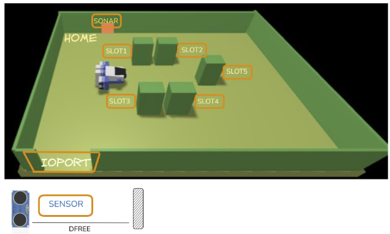
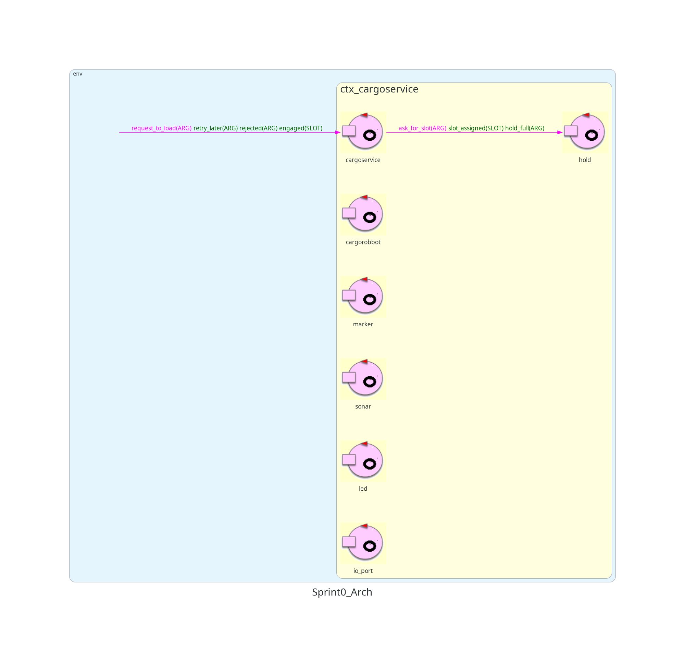

# Sprint0

## Indice

- [Introduzione](#introduzione)
- [Requisiti](#requisiti)
- [Analisi dei Requisiti](#analisi-dei-requisiti)
- [Analisi del problema](#analisi-del-problema)
  - [Core business](#core-business)
  - [Infrastruttura fornita](#infrastruttura-fornita)
  - [Motivazione sull'utilizzo del metamodello Qak](#motivazione-sullutilizzo-del-metamodello-qak)
  - [Architettura di riferimento](#architettura-di-riferimento)
- [Piano di Test](#piano-di-test)
- [Project](#project)
  - [Diagramma dell'architettura iniziale](#diagramma-dellarchitettura-iniziale)
- [Testing](#testing)
- [Deployment](#deployment)
- [Piano di lavoro](#piano-di-lavoro)
- [Team di lavoro](#team-di-lavoro)

## Introduzione

L'obiettivo dello Sprint0 è formalizzare quanto più possibile i requisiti forniti dal committente nel documento [TemaFinale26](https://anatali.github.io/issLab2026/_static/docs/Protobook.pdf#chapter.31), individuare le macro-parti del sistema e la loro natura software, riconoscere il core business, predisporre un primo insieme di TestPlan funzionali e definire un primo modello del sistema da utilizzare come riferimento negli sprint successivi.

In particolare, il primo modello dei requisiti prodotto deve essere comprensibile alla macchina dove possibile, senza introdurre componenti, messaggi o comportamenti che non emergono dai requisiti.

## Requisiti

I requisiti sono descritti dal committente nel documento [TF2026 Requirements](https://anatali.github.io/issLab2026/_static/docs/Protobook.pdf#section.31.1). Per comodità, riportiamo di seguito il suddetto documento, tradotto in lingua italiana:

Una compagnia di trasporto marittimo merci, da ora in poi semplicemente **company**, intende automatizzare le operazioni di carico dei **container** nella stiva della nave, da ora in poi semplicemente **hold**. A tale scopo, la compagnia intende impiegare un robot a guida differenziale, da ora in poi chiamato **cargorobot**.

La hold è un’area rettangolare e piana dotata di una porta di Input/Output, chiamata **IOPort**. L’area fornisce `4 slot` per immagazzinare i container e uno slot chiamato **slot5**.



Nella figura sopra:

- I **slots1-4** rappresentano le aree della stiva riservate a contenere un _container_ ciascuna.
- Lo **slot5** rappresenta un’area in cui il _cargorobot_ deve depositare temporaneamente un container prima di collocarlo in uno degli _slots1-4_. Durante questa sosta temporanea, un dispositivo chiamato marker etichetta il container con un codice a barre identificativo e segnala quando l’attività di marcatura è completata.
- L’**IOPort** è un dispositivo dotato di un **pushbutton** e di un **display**. Il _pushbutton_ viene premuto dal cliente per inviare una richiesta di carico di un container nella stiva. Il _display_ viene usato per mostrare la risposta alla richiesta e per mostrare lo stato corrente dell'_hold_.
- Il **sensore** associato all’_IOPort_ è un dispositivo, cioè un _sonar_, usato per rilevare la presenza di un container quando misura una distanza D tale che D < DFREE / 2 per un tempo ragionevole, per esempio 3 secondi.

La compagnia ci chiede di costruire un servizio chiamato **cargoservice**, che deve funzionare come segue. Il _cargoservice_ è in grado di ricevere una **richiesta di carico** di un container inviata da un cliente tramite il _pushbutton_ dell’_IOPort_.

Il servizio:

- Invia la risposta `retrylater` se l’**IOPort** è attualmente occupato da un container oppure se il sistema è _Out of service_.
- Rifiuta la richiesta quando la stiva è già piena, cioè quando gli `slots1-4` sono già occupati.
- Altrimenti, considera il sistema come **engaged**, individua uno slot libero e restituisce come risposta il nome dello slot riservato. Mentre il sistema è engaged, deve lampeggiare un LED.

Quando la _richiesta di carico_ viene accettata, il cliente deve spostare il container nell’area del _sensore_ entro un tempo prefissato, per esempio 30 secondi; altrimenti il sistema torna nello stato **disengaged**. Successivamente, il _cargoservice_ usa il _cargorobot_ per spostare il container dall’_IOPort_ allo _slot5_, dove il container viene marcato, e poi allo slot riservato.

Il servizio deve inoltre mostrare sul _display_ dell’_IOPort_:

- lo stato corrente dell'_hold_;
- il messaggio **'Service working'**, quando tutto procede correttamente;
- il messaggio **'Out of service'** se il _sensore sonar_ misura una distanza D > DFREE per almeno 3 secondi, evento che potrebbe indicare un guasto del _sonar_.

**Nota**: Si precisa che il testo riportato sopra costituisce una traduzione in lingua italiana, realizzata esclusivamente per facilitarne la lettura e rimanere coerenti con la lingua del documento. La specifica ufficiale del committente rimane quella contenuta nel documento originale **TemaFinale26**, in particolare nella sezione [TF2026 Requirements](https://anatali.github.io/issLab2026/_static/docs/Protobook.pdf#section.31.1), redatta in lingua inglese. Pertanto, la traduzione non intende sostituire né modificare la specifica originale.

## Analisi dei Requisiti

Seguendo i requisiti del committente, abbiamo individuato i seguenti **macrocomponenti**:

- **cargoservice**
- **cargorobot**
- **sonar**
- **IOPort**
- **hold**
- **led**
- **slot 5**, d'ora in poi identificato con **marker**
- **slot** numerati dall' 1 al 4
- **container**

Il sistema richiesto dal committente ha l’obiettivo di automatizzare le operazioni di caricamento e deposito dei container all’interno della stiva di una nave, mediante l’impiego di un robot a guida differenziale denominato `cargorobot`, coordinato dal servizio software `cargoservice`.


##### Cargoservice
Il `cargoservice` rappresenta il servizio applicativo responsabile della ricezione e della valutazione delle richieste di caricamento, nonché del coordinamento delle operazioni necessarie al loro completamento. In particolare, il servizio restituisce la risposta _out_of_service_ in caso di fallimento del `sonar` oppure restituisce _retry_later_ qualora l'`IOPort` risulti occupata; rifiuta invece la richiesta quando tutti gli slot di deposito permanente risultano occupati. In presenza di almeno uno slot disponibile e in assenza delle precedenti condizioni, il servizio accetta la richiesta, individua e riserva uno slot libero, ne comunica il nome al cliente e pone il sistema nello stato _engaged_.

##### Cargorobot


##### Sonar
Un sensore `sonar` è incaricato di rilevare la presenza di un container nell’area di ingresso e di segnalare eventuali condizioni anomale della distanza misurata. Il cliente è tenuto a collocare il container nell’area di rilevamento del sonar entro un intervallo di tempo prefissato, trascorso il quale, in assenza del container, `cargoservice` torna nello stato _disengaged_.

##### IOPort
L’interazione dell'utente con il sistema avviene attraverso la `IOPort`, interfaccia verso il cliente, dotata di un pulsante (_pushbutton_) per inoltrare le richieste di caricamento e di un _display_ per visualizzare le risposte, lo stato corrente della stiva e le informazioni sul funzionamento del servizio.

##### Hold
L'`hold` (stiva) costituisce l’ambiente fisico operativo ed è organizzata in quattro aree di deposito permanente, denominate `slot1–slot4`, ciascuna destinata a ospitare un solo container, e in un’area di deposito temporaneo, `slot5`, dedicata alle operazioni di marcatura.

```
interface IHold {
    val ioPort: Pair<IPoint, IContainer?>
    val slotNumber: Int
    fun getFreeSlot(): ISlot?
    fun getPoint(id: String): IPoint?
    fun codeAssigned(id: String, code: Int?)
}
```

##### Led
Dispositivo che lampeggia mentre il `cargoservice` è in stato _engaged_.

##### Marker
Una volta rilevata la presenza del container, il cargoservice si avvale del cargorobot per trasferirlo dalla IOPort allo slot5, dove il dispositivo `marker` applica un codice a barre identificativo e segnala il completamento dell’operazione di marcatura.
##### Slot
**TODO: spiegare interfaccia slot**
```
interface ISlot {
    val id: String
    var container: IContainer?
    val point: IPoint
}
```
**TODO: spiegare interfaccia point**

```
interface IPoint {
    val x: Int
    val y: Int
}
```

##### Container
**TODO: spiegare interfaccia Container**

```
interface IContainer {
    val code: Int?
}
```
```
Successivamente, il robot provvede al trasferimento del container nello slot precedentemente riservato. Durante il funzionamento, la IOPort deve inoltre visualizzare lo stato corrente della stiva e il messaggio _Service working_ quando il sistema opera regolarmente, oppure _Out of service_ qualora il sonar rilevi, per almeno tre secondi, una distanza superiore a `DFREE`, condizione indicativa di una possibile anomalia del sensore.
```

### Infrastruttura fornita

Si riportano i macrocomponenti software del sistema che sono già forniti dal committente come `WEnv` che rappresenta un'ambiente virtuale che simula la hold e diversi componenti per il controllo robotico: `RobotObj26` (POJO), `VirtualRobot26`, `VirtuRobotService26` e `RobotSmart26`. L'analisi successiva dovrà confrontare capacità, interfacce e costi d'integrazione di questi strumenti per stabilire quale supporto utilizzare nel `cargorobot`. Non è richiesto di riscrivere da zero tutte le funzionalità robotiche.

### Motivazione sull'utilizzo del metamodello Qak

La scelta del DSL **Quasi Actor Kotlin** (Qak) è motivata da due vantaggi principali offerti da questo metamodello rispetto agli altri linguaggi "general purpose":

- Il concetto di **Interconnessione** è supportato nativamente in Qak: nel dominio descritto del problema possiamo notare che la comunicazione tra i vari attori presenti è essenziale per il corretto funzionamento del sistema, e un solo GPL non permette di esprimere questa necessità nativamente.

- Progettazione orientata ad attori e microservizi: in un GPL saremmo limitati vedere gli elementi del sistema come dei semplici POJO. Qak invece permette di esprimere gli elementi del sistema come attori, supportando l'**Actor Model** (il paradigma di progettazione ad attori), questo ci permette di sviluppare il nostro progetto attorno alle interaizoni tra attori, e non sulla semplice regolazione di uno o più flussi di dati.

Queste due caratteristiche permettono di ridurre significativamente l'**Abstraction Gap** tra Qak e il dominio del problema. Utilizzare solamente un GPL presenterebbe un Abstraction gap maggiore che comporterebbe a maggiore complessità nelle fasi di implementazione del progetto.

Infine, l'adozione del metamodello QAK è anche motivata dalla presenza di una **Software Factory** che è in grado di generare automaticamente codice Kotlin a partire dai modelli scritti in linguaggio QAK. Questo permette non solo di ottenere dei modelli eseguibili "off-the-bat", ma supporta anche un processo di **Rapida Prototipazione** in cui si permette agli sviluppatori di valutare la fattibilità di particolari soluzioni implementative già nelle fasi di progettazione.


Dall’analisi dei requisiti emerge un sistema caratterizzato dalla cooperazione di diverse entità software e dispositivi fisici. Il numero di nodi computazionali ricavato dai requisiti è almeno 4: 
 - un dispositivo per il sonar
 - un dispositivo dotato di un LED
 - un computer per eseguire `cargoservice`
 - un dispositivo per interagire con l'`IOPort`

In caso durante la fase di progettazione dovesse sorgere la necessità di usare altri nodi, essi dovrano essere definiti nelle successive fasi di analisi e progettazione. Possiamo dedurre che il `cargoservice` è un servizio, mentre le altre entità includono dispositivi fisici, un'interfaccia e un sottosistema robotico.


Dopo un primo confronto con il commitente, sono sorti altri requisiti, in particolare:

- la presenza di una Web GUI per la IOPort
- un dispositivo PicoW per il sonar e il led

Questi ulteriori requisiti introducono dei vincoli tecnologici che potrebbero richiedere l’impiego di tecnologie e linguaggi differenti.

L'interazione principale è una richiesta dalla IOPort al cargoservice, seguita da una risposta. Un primo vocabolario Qak, con nomi proposti dagli analisti per gli esiti non nominati dal committente, è:

```
Request load_container : load_container(ARG)
Reply load_accepted : load_accepted(SLOT) for load_container
Reply load_refused : load_refused(CAUSE) for load_container
Reply retrylater : retrylater(CAUSE) for load_container
```

Il frammento descrive solo i messaggi: non è un modello Qak completo già validato o eseguibile. Inoltre, le interazioni rimanenti tramite messaggi verranno discusse e modellate durante le fasi di analisi nei successivi sprint ma possiamo già esplicitarne di altre come Cliente/IOPort per la richiesta, cargoservice/cargorobot per movimentazione, sonar per rilevamento, marker per la segnalazione di marcatura, display per la visualizzazione e LED per il lampeggio.

Infine, non è definito nei requisiti dove collocare i macro-componenti individuati, quindi si evita di fissare fin d'ora Context Qak o indirizzi di rete definitivi. Mentre, le responsabilità funzionali sono distribuite nel modo seguente:

- il servizio (`cargoservice`) gestisce il caricamento;
- la `IOPort` gestisce il contatto con il cliente;
- il `sonar` misura;
- il `marker` marca;
- il `cargorobot` trasporta.

Nessuna ulteriore scomposizione interna del servizio è imposta dal committente.

## Analisi del problema

### Core business

Il core business consiste nel coordinamento del processo di caricamento, dalla richiesta all'eventuale deposito nello slot riservato. Il servizio deve consentire l'accettazione solo nelle condizioni indicate, riservare lo slot e organizzare le operazioni: posizionamento del container, trasporto allo `slot5`, marcatura e trasporto finale. Le operazioni sensoriali, l'attuazione dei movimenti e la visualizzazione sono funzionalità di supporto al processo.

```
Cliente → IOPort → cargoservice → esito della richiesta
                                      │
                        [richiesta accettata]
                                      ↓
                      slot riservato; sistema engaged
                                      ↓
                         attesa del container
                           │           │
                         timeout    rilevamento
                           ↓           ↓
                      disengaged    cargorobot
                                       ↓
                                     slot5
                                       ↓
                                   marcatura
                                       ↓
                                 slot riservato
```

Questo è un flusso funzionale, non un diagramma di attori Qak o di deployment. Le transizioni del led e il rilascio della prenotazione dopo il timeout non vengono completati arbitrariamente laddove il testo non li specifica.


### Architettura di riferimento

Nel modello qak, ogni attore possiede uno stato privato e un proprio comportamento. Gli attori non accedono direttamente allo stato interno degli altri attori, ma coordinano le proprie attività mediante lo scambio di messaggi.

L'assenza di memoria condivisa è considerata un vincolo del modello logico: anche quando più attori vengono eseguiti nella stessa JVM, il loro coordinamento deve avvenire tramite messaggi e non mediante accesso diretto a variabili mutabili condivise.

La motivazione di Qak non determina automaticamente il numero degli attori o dei Context e non obbliga a rappresentare ogni dispositivo fisico come QActor.

## Piano di Test

In questa fase iniziale sono stati individuati i seguenti casi di test funzionali, derivati direttamente dai requisiti del committente, con l'obiettivo di verificare il comportamento del sistema in risposta a una richiesta di caricamento.

```
abstract class HoldTestPlan {

	IHold hold;

	abstract IHold createHold();
	abstract IContainer createContainer();

	@Before
	public void setUp() {
		hold = createHold();
	}

	@Test
	public void getting_a_slot_while_all_hold_slots_are_free_should_return_a_non_null_value() {
		ISlot freeSlot = hold.getFreeSlot();
		Assert.assertNotNull("There are no slots available", freeSlot);
	}

	@Test
	public void getting_a_slot_while_they_are_all_occupied_should_return_a_null_value() {
		for (int i = 0; i < hold.getSlotNumber(); i++) {
			ISlot slot = hold.getFreeSlot();
			Assert.assertNotNull(slot);
			hold.codeAssigned(slot.getId(), i);
		}

		assertNull(hold.getFreeSlot());
	}
}
```

| Condizione iniziale e richiesta                     | Risultato atteso    |
| --------------------------------------------------- | ------------------- |
| IOPort libera, servizio operativo, slot disponibile | Risposta accettata  |
| IOPort occupata da un container                     | `retrylater`        |
| Servizio Out of service                             | `retrylater`        |
| Hold piena, IOPort libera e servizio operativo      | Richiesta rifiutata |

I casi individuati costituiscono un primo TestPlan funzionale, che verrà progressivamente formalizzato in test automatizzati durante gli sprint successivi, parallelamente allo sviluppo dei componenti software necessari. Ulteriori TestPlan, relativi alle altre funzionalità del sistema, saranno definiti e approfonditi negli sprint che le affronteranno.

## Project

### Diagramma dell'architettura iniziale

I requisiti permettono una vista logica delle macro-parti, ma non ancora una distribuzione sui nodi. Il seguente diagramma rappresenta l'architettura iniziale di riferimento per lo sprint 1 e le relazioni qui sotto mostrano chi interagisce funzionalmente con chi, senza imporre un protocollo concreto o un attore per ogni dispositivo.

- ctx_cargoservice: cargoservice, hold, cargorobot, marker, sonar, led, ioport;



**Goal dello Sprint1**: realizzare un primo prototipo dell'interazione IOPort–cargoservice che gestisca accettazione, rifiuto e retrylater, utilizzando mock se necessari. Il trasporto effettivo e l'integrazione dei dispositivi sono rinviati ai successivi incrementi.

## Testing

Durante lo Sprint0 non sono stati implementati né eseguiti test automatici, poiché non è ancora disponibile un prototipo del sistema su cui verificarne il comportamento.

L'implementazione e l'esecuzione dei test funzionali definiti nel Piano di Test sono pertanto rimandate agli sprint successivi, durante i quali verranno sviluppati progressivamente gli attori Qak e le interazioni necessarie, eventualmente ricorrendo a componenti mock per le funzionalità non ancora realizzate.

## Deployment

Non previsto per lo Sprint0: non è ancora disponibile un prototipo da distribuire.

## Piano di lavoro

Oltre a questo Sprint0 iniziale, nel nostro processo Scrum abbiamo previsto tre sprint operativi:

1. Sprint 1
   - cargoservice (core business del sistema)
   - cargorobot
   - marker
   - hold
2. Sprint 2
   - sonar
   - led
   - IOPort
   - web-gui
   - display e pushbutton

Eventuali modifiche significative potranno essere apportate solo in presenza di esigenze straordinarie, cambiamenti rilevanti durante il percorso progettuale, o situazioni tali da non poter essere ignorate.

## Team di lavoro

**Francesco Cenerini, Niccolò Leoncini, Pietro Milo Tasinato**.
Tutti e tre i componenti del team hanno partecipato attivamente a tutte le fasi di scrittura e stesura dello sprint, dando il loro contributo in forma di conoscenze e ore di lavoro.
