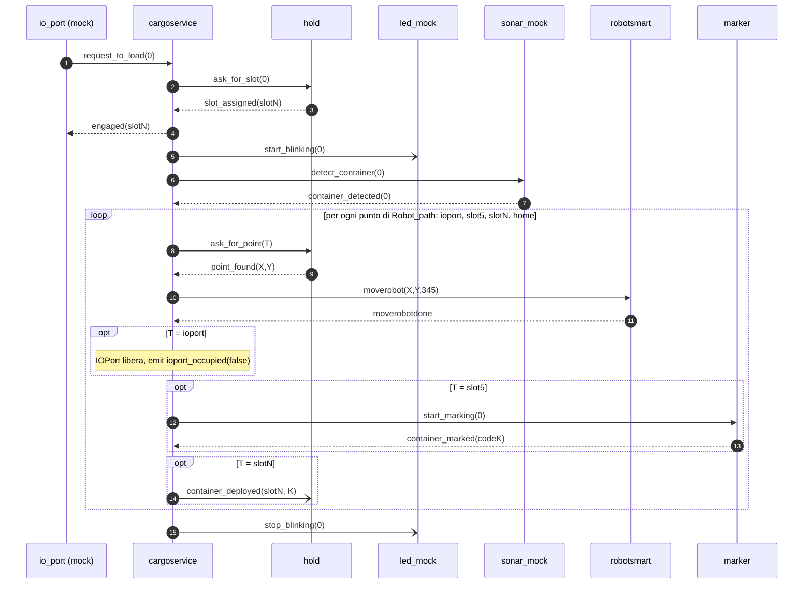

# Sprint1

## Indice

- [Goal dello Sprint](#goal-dello-sprint)
- [Analisi dei requisiti](#analisi-dei-requisiti)
- [Analisi del Problema](#analisi-del-problema)
- [Piano di Test](#piano-di-test)
- [Project](#project)
- [Testing](#testing)
- [Deployment](#deployment)
- [Piano di lavoro](#piano-di-lavoro)
- [Team di lavoro](#team-di-lavoro)

## Goal dello Sprint

Requisiti, macro-componenti, core business, scelta di QAK e interfacce di dominio sono nello [Sprint0](../sprint0/sprint0.md). Lo Sprint1 realizza ciò che lo Sprint0 ha assegnato a questo incremento (`cargoservice`, `cargorobot`, `marker`, `hold`):

> **Prototipo eseguibile del core business del `cargoservice`**: gestione di una richiesta di carico proveniente dall'IOPort (esiti `retrylater`, rifiuto per hold piena, accettazione con slot riservato) e coordinamento dell'intero ciclo di carico — attesa del container, trasporto `IOPort → slot5 → slot riservato → home`, marcatura, aggiornamento della hold — superando i TestPlan definiti prima dello sviluppo.

IOPort/pushbutton, sonar e led sono **attori mock** con il vocabolario di messaggi che avranno le versioni definitive (Web GUI e Pico W, Sprint2), così da sostituirli senza toccare il `cargoservice`.

## Analisi dei requisiti

Dei requisiti formalizzati nello Sprint0 (numerati qui R1–R9 per comodità) lo Sprint1 sviluppa il nucleo funzionale del servizio. Sono realizzati **per intero** il rifiuto della richiesta quando la hold è piena (R3), l'accettazione con individuazione e comunicazione dello slot riservato (R4) e il trasporto del container, con il cargorobot, dall'IOPort allo slot5 per la marcatura e poi allo slot riservato (R7), usando il robot virtuale fornito dal committente.

I dispositivi che lo Sprint2 realizzerà davvero sono **simulati con attori mock** che ne rispettano il vocabolario di messaggi: la richiesta di carico (R1) nasce dalla simulazione della pressione del pulsante, il led lampeggiante durante lo stato _engaged_ (R5) è un attore che si limita a segnalare "acceso/spento", e l'attesa del container entro il tempo prefissato (R6) è affidata a un sonar mock che risponde "container rilevato" oppure "tempo scaduto". La risposta `retrylater` (R2) è gestita quando l'IOPort è occupata, ma solo **parzialmente**: lo stato _Out of service_ non può ancora essere raggiunto, perché richiede la misura reale del sonar. Restano **rinviati allo Sprint2** il display con lo stato della hold e i messaggi `Service working` / `Out of service` (R8) e il rilevamento di `D > DFREE` per almeno 3 secondi (R9).

## Analisi del Problema

Il testo dei requisiti lascia alcuni punti non specificati. Per ciascuno è stata adottata un'**assunzione**, da confermare con il committente. Se arriva una nuova richiesta mentre il sistema è già _engaged_ (Q1) si risponde `retrylater`, perché c'è un solo robot e un solo IOPort e quindi non è possibile gestire due carichi concorrenti. Gli slot sono assegnati nell'ordine `slot1 … slot4`, scegliendo il primo libero (Q2). "Riservare" uno slot (Q3) è inteso come una riserva implicita, che non richiede alcun rilascio in caso di timeout. I 30 secondi di attesa del container (Q4) sono misurati, per ora, dal sonar mock, che risponde `sonar_timeout`. Se l'IOPort è occupata e la hold è piena contemporaneamente (Q5) prevale `retrylater`, perché le condizioni temporanee sono valutate per prime, nell'ordine in cui compaiono nel testo. Infine, il comportamento da adottare quando il robot non riesce a completare un movimento (Q6) non è specificato dal committente e non è gestito nel prototipo.

Il virtual environment non offre primitive di presa/rilascio: il "prelievo" e il "deposito" del container sono modellati come _arrivo del robot_ nel punto corrispondente, più l'aggiornamento logico della hold.

### Il cargorobot: quale componente usare

Lo Sprint0 ha lasciato aperto quale componente fornito dal committente esprima il `cargorobot`.

| Componente              | Natura       | Livello offerto                       | Adeguatezza                                                        |
| ----------------------- | ------------ | ------------------------------------- | ------------------------------------------------------------------ |
| `RobotObj26`            | POJO         | Mosse di base                         | Non è un servizio; navigazione a nostro carico.                    |
| `VirtualRobot26` (WEnv) | Servizio     | Comandi cril a tempo (HTTP/WebSocket) | Troppo basso: percorsi e collisioni a nostro carico.               |
| `VirtuRobotService26`   | Servizio     | Comandi di base e passi               | Come sopra.                                                        |
| **`RobotSmart26`**      | Servizio QAK | **Destinazione come cella `(X,Y)`**   | **Scelto**: pianifica il percorso con A\* sulla mappa di contesto. |

`RobotSmart26` offre `moverobot(TARGETX, TARGETY, STEPTIME)` con reply `moverobotdone` / `moverobotfailed(PLANDONE, PLANTODO)` e `setrobotstate: setpos(X,Y,D)` per la posizione iniziale; gira nel Context `ctx_smartrobot` (porta 8020) sopra WEnv.

Abbiamo deciso che il `cargoservice` usa `robotsmart` direttamente (`ExternalQActor`), **senza un attore `cargorobot` intermedio**: un wrapper che inoltra `moverobot` non aggiungerebbe comportamento. La traduzione _nome del punto → coordinate_ è affidata alla `hold`, che conosce la geometria (`HoldMap.json`). È una **variazione rispetto al piano dello Sprint0**; il wrapper potrà essere introdotto se servirà un comportamento proprio del robot (es. movimento con/senza container), perché il `cargoservice` dipende solo dal contratto `moverobot`.

### Il problema della prenotazione dello slot

"Riservare" può significare (1) **riserva esplicita** nella hold, con messaggio di rilascio se il container non arriva — comportamento che il testo non specifica; (2) **riserva implicita**: lo slot è marcato occupato solo al deposito (`container_deployed`), e fra accettazione e deposito nessun altro può riceverlo perché il `cargoservice` serializza i carichi (`Is_engaged`).

Scelta: **riserva implicita** (con un solo IOPort e un solo robot la serializzazione garantisce già l'unicità). Limite dichiarato: vale finché il `cargoservice` è l'unico cliente di `ask_for_slot`.

Rispetto alle interfacce dello Sprint0, `IHold` guadagna `slotNumber`, `getPoint(id)` e `markSlot(id, code)`, e `ISlot` guadagna `val point: IPoint` e un `container` modificabile.

### Il problema della concorrenza delle richieste

Il pulsante può essere premuto anche durante un carico. Se il `cargoservice` lasciasse la richiesta nella coda mentre attende il robot, il `retrylater` arriverebbe solo a carico finito. Quindi **ogni stato di attesa** del `cargoservice` ha anche la transizione `whenRequest request_to_load`, verso uno stato che risponde subito `retrylater` e torna all'attesa. Poiché un attore elabora un messaggio alla volta, controllo e impostazione di `Is_engaged` sono atomici: due richieste non possono essere accettate insieme.

### Tempo e mock

`sonar_mock` risponde subito `container_detected` (flag `success = true`) o, con `success = false`, attende 30 s e risponde `sonar_timeout`. Il `marker` simula la marcatura con 2 s di ritardo e restituisce `code1`, `code2`, … (utile ai test). `STEPTIME` del robot è 345 ms: un ciclo completo dura decine di secondi, quindi i test end-to-end hanno attese lunghe.

## Piano di Test

Il piano è stato definito prima dell'implementazione e indica **che cosa va dimostrato**; i test automatici che lo realizzano sono descritti nella sezione [Testing](#testing). Le verifiche avvengono dall'esterno del sistema: si inviano request e dispatch al Context `ctx_cargoservice` (TCP, porta 8000) e si controllano identificatore e payload delle reply.

Verifiche sui singoli componenti:

1. La hold conosce le coordinate di tutti i punti necessari al ciclo di carico (`ioport`, `slot5`, `home`, `slot1`–`slot4`) e segnala in modo esplicito una posizione inesistente (R7).
2. A ogni richiesta di slot la hold risponde con uno slot valido (`slot1`–`slot4`) oppure con "hold piena", qualunque sia il suo stato (R3, R4).
3. Il sonar segnala la presenza del container (R6).
4. Il marker assegna ai container codici progressivi: due marcature successive producono codici distinti e crescenti (R7).

Verifiche sul comportamento del `cargoservice` e della hold in uso reale:

5. Alla richiesta di carico il `cargoservice` risponde con uno solo degli esiti previsti dal committente: accettazione con un nome di slot valido, `retrylater` oppure rifiuto (R1–R4).
6. Partendo da una hold vuota, quattro registrazioni di container occupano quattro slot distinti, nessuno viene assegnato due volte e, a hold piena, la richiesta di slot dà "hold piena" (R3, R4).
7. Il ciclo di carico completo, con il robot virtuale, si conclude con il container registrato nella hold: dopo la pressione del pulsante lo slot libero cambia (R1, R4, R7).
8. Con la hold piena la richiesta di carico non modifica la hold e viene rifiutata (R3).
9. Una nuova richiesta durante un carico riceve `retrylater`, mentre la prima è stata accettata con lo stesso slot che la hold indicava come libero (R2, Q1).

I test non coperti dal piano in questo sprint sono: il timeout dell'attesa del container (il sonar mock risponde sempre "container rilevato"), `retrylater` per _Out of service_ (stato non ancora raggiungibile, R9), il comportamento del led (osservabile solo in console) e il percorso del robot (osservabile nella GUI di RobotSmart26 e, indirettamente, dall'esito del ciclo completo).

## Project

### Messaggi

I nomi sono allineati ai termini dei requisiti (rispetto al vocabolario provvisorio dello Sprint0: `request_to_load`, `engaged`, `rejected`, `retrylater`).

```
Request request_to_load : request_to_load(ARG)
Reply   retrylater      : retrylater(ARG)  for request_to_load
Reply   rejected        : rejected(ARG)    for request_to_load
Reply   engaged         : engaged(SLOT)    for request_to_load

Request ask_for_slot    : ask_for_slot(ARG)
Reply   slot_assigned   : slot_assigned(ID)    for ask_for_slot
Reply   hold_full       : hold_full(ARG)       for ask_for_slot
Request ask_for_point   : ask_for_point(ID)
Reply   point_found     : point_found(X,Y)     for ask_for_point
Reply   point_not_found : point_not_found(ARG) for ask_for_point
Dispatch container_deployed : container_deployed(SlotId, Code)

Request detect_container   : detect_container(ARG)
Reply   container_detected : container_detected(ARG) for detect_container
Reply   sonar_timeout      : sonar_timeout(ARG)      for detect_container
Dispatch start_blinking : start_blinking(ARG)
Dispatch stop_blinking  : stop_blinking(ARG)

Request start_marking    : start_marking(ARG)
Reply   container_marked : container_marked(BARCODE) for start_marking

Dispatch setrobotstate  : setpos(X,Y,D)
Request  moverobot      : moverobot(TARGETX, TARGETY, STEPTIME)
Reply    moverobotdone  : moverobotdone(ARG)                  for moverobot
Reply    moverobotfailed: moverobotfailed(PLANDONE, PLANTODO) for moverobot

Event    ioport_occupied : io_port_occupied(ARG)
Dispatch press_button    : press_button(ARG)   // simulazione del pushbutton
```

Scelte sul tipo di messaggio: **Request/Reply** quando l'esito cambia il comportamento del chiamante; **Dispatch** per notifiche senza risposta; **Event** per `ioport_occupied`, che chiunque (in particolare il futuro display) potrà osservare. Il marker risponde con una **Reply** (non un Event): c'è un solo richiedente, che lega la risposta alla propria richiesta.

### Il cargoservice

**Stato interno:** `Is_engaged` (richiesta accettata, carico non terminato), `Io_port_occupied` (container rilevato e non ancora prelevato), `System_out_of_service` (mai impostato in Sprint1), `Slot_id`, `Robot_path` (punti da raggiungere: `ioport`, `slot5`, slot riservato, `home`), `Target`, `Code`.



| Fase                 | Stati QAK                                                                                 | Comportamento                                                                                                                               |
| -------------------- | ----------------------------------------------------------------------------------------- | ------------------------------------------------------------------------------------------------------------------------------------------- |
| Avvio e riposo       | `setup`, `disengaged`                                                                     | `setup` allinea il robot (`setpos(0,0,down)`); `disengaged` azzera `Is_engaged`, spegne il led, attende `request_to_load`.                  |
| Valutazione          | `start_engage`, `retry_state`                                                             | Se `Io_port_occupied \|\| System_out_of_service \|\| Is_engaged` → `retrylater(0)`.                                                         |
| Prenotazione         | `ask_slot`, `wait_slot`, `hold_full`, `engaged`                                           | Pone `Is_engaged`, chiede lo slot; `hold_full` → `rejected(0)`; `slot_assigned` → costruisce `Robot_path`, `engaged(slot)`, avvia il led.   |
| Attesa container     | `request_sonar`, `wait_sonar`, `container_ready`, `sonar_timeout_state`                   | `sonar_timeout` → azzera il carico, spegne il led, torna a `disengaged`; `container_detected` → `Io_port_occupied = true`.                  |
| Trasporto            | `check_target`, `get_point`, `wait_point`, `move_robot`, `wait_robot`, `moverobotdone`    | Prossimo punto di `Robot_path` → coordinate dalla hold → `moverobot` → attesa reply. Raggiunto `ioport` libera l'IOPort ed emette l'evento. |
| Marcatura e deposito | `request_marker`, `wait_marker`, `container_marked`, `check_reserved_slot`, `notify_hold` | A `slot5` chiede la marcatura e memorizza il codice; allo slot riservato invia `container_deployed`.                                        |
| Chiusura             | `loading_completed`                                                                       | `Robot_path` vuoto (robot in `home`): azzera lo stato, spegne il led, torna a `disengaged`.                                                 |

**Nota**: nello Sprint1 `Io_port_occupied` è sempre coperto da `Is_engaged` (il sonar è interrogato solo dopo l'accettazione); diventerà significativo con il sonar reale.

### Gli altri attori

- **`hold`**: incapsula l'oggetto `Hold` (caricato da `HoldMap.json`). `ask_for_slot` → primo slot libero o `hold_full`; `ask_for_point` → `point_found` o `point_not_found`; `container_deployed` → `markSlot` (se il codice non è un intero valido, errore in console e stato invariato).
- **`marker`**: `start_marking` → attesa 2 s → `container_marked(code<N>)` con contatore progressivo.
- **`io_port`, `sonar_mock`, `led_mock`**: mock descritti sopra; `io_port` trasforma `press_button` in `request_to_load` e conta gli esiti ricevuti.

### Diagramma dell'architettura

TODO (lascia vuoto per diagramma autogenerato in png dal codice py).

## Testing

Tutti i test sono nella classe [`Sprint1Test.java`](../project_Cargoservice/cargoservice_sprint1/src/test/java/Sprint1Test.java) (JUnit 4). Ogni test apre una connessione TCP verso `localhost:8000` (`@Before`), la chiude al termine (`@After`) e dialoga direttamente con gli attori del Context `ctx_cargoservice`. I test `test01`–`test04` verificano il contratto dei singoli attori (`hold`, `sonar_mock`, `marker`); `test05`–`test09` verificano il `cargoservice` con il sistema completo, e `test07` e `test09` richiedono il robot virtuale. Nei frammenti che seguono sono omesse le istruzioni `System.out.println` di log.

**Avvertenza:** Alcuni test dipendono dallo stato condiviso della hold: `test06` la riempie, `test08` presuppone che sia piena, `test05` avvia un vero carico se la richiesta è accettata. La classe non impone un ordine di esecuzione, quindi questi test vanno lanciati **singolarmente su un sistema riavviato**.

### Funzioni di supporto

I test usano alcune funzioni ausiliarie che nascondono il formato dei messaggi:

```java
private IApplMessage request(String actor, String id, String payload) throws Exception {
    IApplMessage req = CommUtils.buildRequest(SENDER, id, payload, actor);
    IApplMessage reply = conn.request(req, REQUEST_TIMEOUT_MS);   // 12 s
    assertNotNull("Reply mancante: " + req, reply);
    return reply;
}

private void dispatch(String actor, String id, String payload) throws Exception {
    conn.forward(CommUtils.buildDispatch(SENDER, id, payload, actor));
}

private IApplMessage slot() throws Exception {
    return request("hold", "ask_for_slot", "ask_for_slot(0)");
}

private static void isReply(IApplMessage reply, String id) {
    assertEquals("Reply inattesa: " + reply, id, reply.msgId());
}

private static void validSlot(String value) {
    assertTrue("Slot non valido: " + value,
            Arrays.asList("slot1", "slot2", "slot3", "slot4").contains(value));
}

private static void validSlotOrFull(IApplMessage reply) {
    if ("slot_assigned".equals(reply.msgId())) validSlot(oneArg(reply));
    else { isReply(reply, "hold_full"); assertEquals("0", oneArg(reply)); }
}
```

`request` invia una Request e attende la Reply (fino a 12 s), `dispatch` invia un messaggio senza risposta, `slot()` chiede uno slot alla hold, `isReply` controlla l'identificatore della reply, `validSlot` e `validSlotOrFull` controllano che il payload sia uno slot valido (o la risposta "hold piena"). Le funzioni `args` e `oneArg` (non riportate) estraggono dal payload `nome(a,b,…)` i singoli argomenti.

### test01_holdCoordinate

Chiede alla hold le coordinate di tutti i punti usati dal ciclo di carico e verifica che siano numeri finiti; verifica inoltre che un punto sconosciuto produca `point_not_found(0)`. Garantisce che il `cargoservice` possa sempre ottenere dalla hold le destinazioni da passare al robot.

```java
@Test(timeout = 30000)
public void test01_holdCoordinate() throws Exception {
    for (String point : Arrays.asList("ioport", "slot5", "home",
            "slot1", "slot2", "slot3", "slot4")) {
        IApplMessage reply = request("hold", "ask_for_point", "ask_for_point(" + point + ")");
        isReply(reply, "point_found");
        String[] xy = args(reply);
        assertEquals("Coordinate di " + point, 2, xy.length);
        assertTrue("X non finita", Double.isFinite(Double.parseDouble(xy[0])));
        assertTrue("Y non finita", Double.isFinite(Double.parseDouble(xy[1])));
    }
    IApplMessage missing = request("hold", "ask_for_point", "ask_for_point(punto_inesistente)");
    isReply(missing, "point_not_found");
    assertEquals("0", oneArg(missing));
}
```

### test02_holdRispostaValidaIndipendentementeDalloStato

Chiede uno slot alla hold e verifica che la risposta sia **valida qualunque sia lo stato della hold**: `slot_assigned` con uno slot da `slot1` a `slot4`, oppure `hold_full(0)`. Il test non presuppone che la hold sia vuota, perché un altro test può averla riempita.

```java
@Test(timeout = 20000)
public void test02_holdRispostaValidaIndipendentementeDalloStato() throws Exception {
    validSlotOrFull(slot());
}
```

### test03_sonarMock

Invia `detect_container(0)` al sonar mock e verifica la risposta `container_detected(0)`. Dimostra il contratto del sonar (richiesta di rilevazione e reply) che il sonar reale dello Sprint2 dovrà rispettare.

```java
@Test(timeout = 20000)
public void test03_sonarMock() throws Exception {
    IApplMessage reply = request("sonar_mock", "detect_container", "detect_container(0)");
    isReply(reply, "container_detected");
    assertEquals("0", oneArg(reply));
}
```

### test04_markerProgressivo

Esegue due marcature consecutive e verifica che i codici abbiano forma `code<N>` e che il secondo numero sia maggiore del primo. Il progressivo è la proprietà che permette di distinguere i container marcati; la durata del test comprende i 2 s di marcatura simulata per ciascuna richiesta.

```java
@Test(timeout = 45000)
public void test04_markerProgressivo() throws Exception {
    IApplMessage first = request("marker", "start_marking", "start_marking(0)");
    IApplMessage second = request("marker", "start_marking", "start_marking(0)");
    isReply(first, "container_marked");
    isReply(second, "container_marked");
    String b1 = oneArg(first);
    String b2 = oneArg(second);
    assertTrue("Barcode errato: " + b1, b1.matches("code\\d+"));
    assertTrue("Barcode errato: " + b2, b2.matches("code\\d+"));
    assertTrue("Barcode non progressivi: " + b1 + ", " + b2,
            Integer.parseInt(b2.substring(4)) > Integer.parseInt(b1.substring(4)));
}
```

### test05_cargoserviceContratto

Invia una `request_to_load(0)` al `cargoservice` e verifica che la reply sia **una di quelle previste dai requisiti**: `engaged` con uno slot valido, oppure `retrylater(0)` o `rejected(0)`. Verifica il contratto verso l'IOPort, non l'esito del carico. Se la richiesta è accettata avvia davvero il movimento del robot, per cui va eseguito su un sistema a riposo.

```java
@Test(timeout = 30000)
public void test05_cargoserviceContratto() throws Exception {
    IApplMessage reply = request("cargoservice", "request_to_load", "request_to_load(0)");
    String id = reply.msgId();
    assertTrue("Reply non prevista: " + reply,
            Arrays.asList("engaged", "retrylater", "rejected").contains(id));
    if ("engaged".equals(id)) validSlot(oneArg(reply));
    else assertEquals("0", oneArg(reply));
}
```

### test06_holdDaVuotoAPieno

Riempie la hold dall'esterno: per quattro volte chiede uno slot, verifica che sia valido e **non già assegnato**, e comunica alla hold il deposito con `container_deployed`. Poiché il dispatch è asincrono, dopo ogni deposito attende (fino a 5 s) che la hold smetta di proporre lo stesso slot. Alla fine verifica che la richiesta successiva dia `hold_full(0)`. È un test **distruttivo**: va eseguito su un sistema appena avviato, con hold vuota.

```java
@Test(timeout = 60000)
public void test06_holdDaVuotoAPieno() throws Exception {
    Set<String> used = new HashSet<>();
    IApplMessage initial = slot();
    isReply(initial, "slot_assigned");              // hold inizialmente vuota

    for (int i = 1; i <= 4; i++) {
        IApplMessage free = i == 1 ? initial : slot();
        isReply(free, "slot_assigned");
        String assigned = oneArg(free);
        validSlot(assigned);
        assertTrue("Slot assegnato due volte: " + assigned, used.add(assigned));
        dispatch("hold", "container_deployed",
                "container_deployed(" + assigned + "," + (1000 + i) + ")");

        // il dispatch è asincrono: attende una risposta diversa dal vecchio slot
        long until = System.nanoTime() + TimeUnit.SECONDS.toNanos(5);
        boolean updated = false;
        while (System.nanoTime() < until) {
            IApplMessage next = slot();
            validSlotOrFull(next);
            if ("hold_full".equals(next.msgId()) || !assigned.equals(oneArg(next))) {
                updated = true;
                break;
            }
            Thread.sleep(100);
        }
        assertTrue("Lo slot non risulta occupato: " + assigned, updated);
    }
    assertEquals(4, used.size());
    IApplMessage full = slot();
    isReply(full, "hold_full");
    assertEquals("0", oneArg(full));
}
```

### test07_caricamentoIntegratoConRobot

Test **end-to-end** del ciclo di carico. Verifica che la hold abbia uno slot libero, simula la pressione del pulsante con `press_button(0)` a `io_port` e, ogni 2 s per un massimo di 120 s, richiede uno slot alla hold. Il carico è completato quando il primo slot libero **cambia** (il container è stato depositato e registrato) oppure la hold risulta piena. Coinvolge `io_port`, `cargoservice`, `hold`, `sonar_mock`, `marker`, `led_mock` e il robot virtuale.

```java
@Test(timeout = 150000)
public void test07_caricamentoIntegratoConRobot() throws Exception {
    // 1. la hold ha uno slot libero
    IApplMessage before = slot();
    isReply(before, "slot_assigned");
    String initialFree = oneArg(before);
    validSlot(initialFree);

    // 2. simula la pressione del pulsante dell'IOPort
    dispatch("io_port", "press_button", "press_button(0)");

    // 3. attende fino a 120 s che il caricamento sia completato
    long deadline = System.nanoTime() + TimeUnit.SECONDS.toNanos(120);
    boolean containerLoaded = false;
    while (System.nanoTime() < deadline) {
        TimeUnit.SECONDS.sleep(2);
        IApplMessage after = slot();
        validSlotOrFull(after);
        if ("hold_full".equals(after.msgId())) { containerLoaded = true; break; }
        // se cambia il primo slot libero, almeno un container è stato registrato
        if (!initialFree.equals(oneArg(after))) { containerLoaded = true; break; }
    }
    // 4. verifica finale
    assertTrue("ERRORE: nessun container registrato nell'hold entro 120 secondi. "
            + "Controllare le console di cargoservice e robotsmart.", containerLoaded);
}
```

### test08_richiestaRifiutataConHoldPieno

Con la hold già piena (precondizione verificata dal test stesso) simula una nuova pressione del pulsante e dopo 2 s verifica che la hold sia ancora piena. La richiesta attraversa il vero `io_port`; l'arrivo di `rejected` all'IOPort è visibile nella console (`IOPORT_MOCK | Request rejected`).

```java
@Test(timeout = 20000)
public void test08_richiestaRifiutataConHoldPieno() throws Exception {
    // precondizione: tutti e quattro gli slot sono occupati
    IApplMessage before = slot();
    isReply(before, "hold_full");
    assertEquals("0", oneArg(before));

    // la richiesta attraversa il vero QActor io_port
    dispatch("io_port", "press_button", "press_button(0)");

    // la hold deve restare piena
    Thread.sleep(2000);
    IApplMessage after = slot();
    isReply(after, "hold_full");
    assertEquals("0", oneArg(after));
}
```

### test09_richiestaDuranteCaricamento_RetryLater

Verifica la gestione delle richieste concorrenti (Q1). La prima `request_to_load` deve ricevere `engaged` con lo **stesso slot** che la hold indicava come libero; dopo 2 s, mentre il carico è in corso, la seconda deve ricevere subito `retrylater(0)`, senza attendere la fine del carico. Richiede il robot virtuale.

```java
@Test(timeout = 60000)
public void test09_richiestaDuranteCaricamento_RetryLater() throws Exception {
    // 1. c'è almeno uno slot libero
    IApplMessage before = slot();
    isReply(before, "slot_assigned");
    String initialSlot = oneArg(before);
    validSlot(initialSlot);

    // 2. prima richiesta: accettata, con lo slot indicato dalla hold
    IApplMessage firstReply = request("cargoservice", "request_to_load", "request_to_load(0)");
    isReply(firstReply, "engaged");
    String assignedSlot = oneArg(firstReply);
    validSlot(assignedSlot);
    assertEquals("Lo slot assegnato non corrisponde a quello disponibile",
            initialSlot, assignedSlot);

    // 3. attende che il caricamento entri nella fase di movimentazione
    TimeUnit.SECONDS.sleep(2);

    // 4. seconda richiesta durante il caricamento: retrylater
    IApplMessage secondReply = request("cargoservice", "request_to_load", "request_to_load(0)");
    isReply(secondReply, "retrylater");
    assertEquals("0", oneArg(secondReply));
}
```

### Esito

| Test                                                   | Requisiti  | Esito        |
| ------------------------------------------------------ | ---------- | ------------ |
| `test01_holdCoordinate`                                | R7         | **Superato** |
| `test02_holdRispostaValidaIndipendentementeDalloStato` | R3, R4     | **Superato** |
| `test03_sonarMock`                                     | R6         | **Superato** |
| `test04_markerProgressivo`                             | R7         | **Superato** |
| `test05_cargoserviceContratto`                         | R1–R4      | **Superato** |
| `test06_holdDaVuotoAPieno`                             | R3, R4     | **Superato** |
| `test07_caricamentoIntegratoConRobot`                  | R1, R4, R7 | **Superato** |
| `test08_richiestaRifiutataConHoldPieno`                | R3         | **Superato** |
| `test09_richiestaDuranteCaricamento_RetryLater`        | R2         | **Superato** |

## Deployment

1. **Ambiente del robot** (fornito dal committente): `robotsmart26.yaml` (Docker) avvia broker MQTT, `wenv` (8090), GUI con mappa di contesto `robotoutgui25` (8085) e `robotsmart26` (8020). Serve per `test07` e `test09`, e per avviare il Context `ctx_cargoservice`.
2. **`cargoservice`**: Context `ctx_cargoservice` sulla porta 8000.

Dalla cartella `project_Cargoservice/cargoservice_sprint1`:

```bash
docker compose -f robotsmart26.yaml up      # ambiente del robot
./gradlew run                              # Context cargoservice (Windows: gradlew.bat run)
./gradlew test --tests "test.java.Sprint1Test.test09_richiestaDuranteCaricamento_RetryLater"
```

Il codice in `src/it/unibo` è generato dalla software factory QAK da `sprint1.qak`.

## Piano di lavoro

1. Analisi dei requisiti del sottoinsieme (R1–R9, assunzioni Q1–Q6).
2. Analisi del problema: scelta di RobotSmart26, prenotazione implicita dello slot, gestione delle richieste concorrenti.
3. Definizione del TestPlan (`Sprint1Test`) prima del codice.
4. Modello QAK del `cargoservice` e degli attori di supporto; dominio Kotlin della hold.
5. Test end-to-end con il robot virtuale e revisione del modello.

**Goal dello Sprint2:** IOPort come Web GUI (pushbutton, display) e sonar/led su Pico W al posto dei mock; misura `D > DFREE` e stato _Out of service_ (R8, R9) con l'obiettivo di chiudere i punti rimasti in sospeso.

## Team di lavoro

**Francesco Cenerini, Niccolò Leoncini, Pietro Milo Tasinato**.
Tutti e tre i componenti del team hanno partecipato attivamente a tutte le fasi di sviluppo e di stesura dello sprint.
